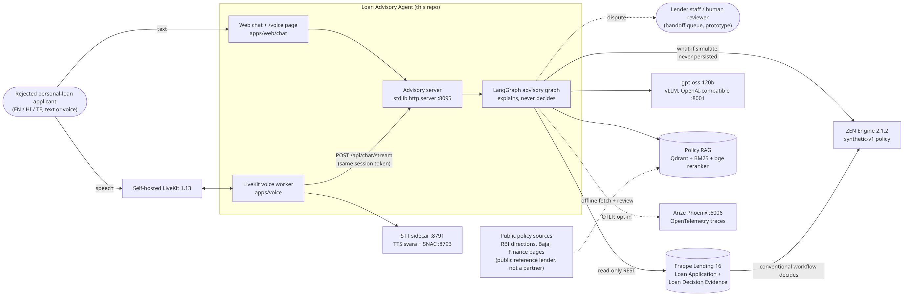

# Loan Advisory Agent

An evidence-grounded advisory agent for **rejected personal-loan applicants**, in **English, Hindi and Telugu**, by text
or voice. It explains the recorded reasons for a decision, shows how they relate to published policy, runs what-if
simulations and suggests legitimate next steps. **It explains; it never decides.** Decisions come only from a
deterministic ZEN rules engine run by the conventional Frappe Lending workflow.

Built for the VaaniLabs.AI capstone (CBIT AI/ML). Repository name is spelled `Load-Advisory-Agent`.

> **Read this first**
> - **All applicant data is synthetic.** The four underwriting thresholds (income ≥ ₹25,000, FOIR ≤ 0.45, credit score
>   ≥ 700, employment tenure ≥ 12 months) are the team's synthetic prototype policy `synthetic-v1`. They are not any
>   lender's real policy, and every answer, decision card and plan says so.
> - **Bajaj Finance Ltd is a *public reference lender, not a partner*.** Its public documents are used to build and
>   evaluate the policy RAG. The design is lender-neutral: the lender is a config profile
>   (`config/lender_profiles/`), and RBI rules are labelled per entity type (bank vs NBFC).
> - Scope is **personal loans only**.

Design and rationale: [APPROACH.md](APPROACH.md). Diagrams: [docs/architecture/](docs/architecture/README.md).



## Features

| Area | What it does | Where |
|---|---|---|
| Decision core | Canonical pydantic schema → ZEN Engine 2.1.2 → rule-level PASS/FAIL evidence; sha256-pinned policy registry that fails closed | `decision_engine/`, `apps/api/src/loan_advisory/application/` |
| Conventional workflow | Frappe Lending 16 lifecycle (SUBMITTED → UNDER_REVIEW → APPROVED / REJECTED / INFO_REQUESTED / MANUAL_REVIEW, plus dispute/resubmit/withdraw); stores a `Loan Decision Evidence` record | `lifecycle.py`, `infra/frappe/` |
| Synthetic bureau (development only) | Local-only FastAPI stand-in for a credit bureau, a deterministic 120-case fixture, a loopback-only client and data-quality gates; the resolved score still goes through unchanged ZEN | `apps/bureau/`, `decision_engine/bureau/`, `application/bureau_intake.py` |
| Advisory agent | One LangGraph `StateGraph`: explain, improve (ZEN-verified plan), what-if (in-memory ZEN, never persisted), policy Q&A with citations, boundary refusals, human handoff | `apps/api/src/loan_advisory/agent/` |
| Guards | Deterministic request guards before the LLM (guarantee, override, record edit, other applicant, injection, auto-submit, dispute, misrepresentation, not-available); answer guards after it (guarantee/decision language, NBFC written-reason claims, ungrounded numbers, citation labels); one rewrite, then a template | `guards.py`, `graph.py` |
| Policy RAG | 38-source register with approval status and supersedes links; BM25 + EmbeddingGemma 2 in Qdrant, weighted RRF, `bge-reranker-v2-m3`; lender-profile filter applied before ranking | `data/sources/`, `rag/`, `config/rag.yaml` |
| Personalisation | Literacy level (low / medium / high) and locale (en / hi / te) shape the wording | `prompts.py` |
| Voice | Self-hosted LiveKit 1.13 + LiveKit Agents 1.8, Silero VAD, IndicConformer-600M (hi/te) and Whisper large-v3-turbo (en) STT, svara-tts-v1 TTS; sentence-streamed answers behind the same guards | `apps/voice/`, `infra/voice/` |
| Observability | OpenTelemetry → self-hosted Arize Phoenix; optional self-hosted Langfuse on the same span tree; message text is not exported unless `AGENT_TRACE_CONTENT=1` (Phoenix) or `LANGFUSE_CAPTURE_CONTENT=1` (Langfuse) | `observability.py`, `langfuse_config.py`, `docs/observability/langfuse.md` |
| Tooling | Ruff + pytest in GitHub Actions on pushes and PRs to `main`; optional pre-commit hook with staged ruff fixes and the test suite | `.github/workflows/ci.yml`, `.githooks/pre-commit` |

The advisory server is Python standard library (`http.server`) with no LiteLLM, Hermes or multi-agent framework; the
LLM is called with plain `requests`. The synthetic bureau (PR #17) is a separate, local-only **FastAPI** service under
`apps/bureau/`; it is not part of the advisory server and never decides credit.

## Quick start

### 1. Decision core only (no Frappe, no GPU)

```bash
pip install -r requirements.txt
python -m pytest tests/test_zen_smoke.py tests/test_p0_integration.py -q
python scripts/development/run_p0.py             # all fixtures + what-if demo
python scripts/development/inspect_zen_trace.py  # decision + result + trace dump
```

### 2. Live Frappe Lending (P1/P3)

Start the stack (frappe_docker clone, outside this repo):
`docker compose --project-name loanrangers -f loanrangers.yml up -d --pull missing`
(site `p1loan.local` → `http://127.0.0.1:8080`). The droplet variant is `infra/frappe/loanrangers.droplet.yml`
(127.0.0.1-only, secrets from env), seeded by `infra/frappe/bootstrap/{create_site,seed}.sh`.

```bash
export FRAPPE_URL=http://127.0.0.1:8080 FRAPPE_API_KEY=<key> FRAPPE_API_SECRET=<secret>
python -m pytest tests/ -q
```

### 3. Advisory agent (text)

Needs an OpenAI-compatible endpoint serving gpt-oss-120b (vLLM in this project), plus the policy corpus and Qdrant
index on disk for policy questions. `requirements.txt` covers the decision core, advisory server, agent graph and
Langfuse SDK (exact pins for `zen-engine` and `langfuse`; `langgraph` is constrained to `>=1.0,<2`; the rest are
floors). The RAG extras are in `requirements-rag.txt`/`requirements-data.txt`. LiveKit Agents, OpenTelemetry and the
STT/TTS stack are still installed outside a requirements file; see [Known gaps](#known-gaps).

```bash
# decide the seeded demo applications first: the agent only explains stored decisions
PYTHONPATH=.:apps/api/src python scripts/agent/prepare_demo.py

# chat server + web UI on http://127.0.0.1:8095
#   --dev-ephemeral-secret   local demo only: no AGENT_SESSION_SECRET needed, tokens die on restart
#   --max-inflight 8         concurrent requests admitted; extra requests get 503 + Retry-After
PYTHONPATH=.:apps/api/src python -m loan_advisory.agent.server --port 8095 --dev-ephemeral-secret
#   --offline   MockStore + in-memory evidence instead of live Frappe
#   --no-rag    do not load the GPU retriever (policy questions abstain)
```

Endpoints: `GET /`, `GET /healthz`, `GET /api/demo-accounts`, `POST /api/session` (demo sign-in, synthetic accounts
only), `GET /api/decision`, `POST /api/chat`, `POST /api/chat/stream` (NDJSON sentences, then the final response),
`POST /api/bureau/run`, `POST /api/livekit-token`, `GET /voice`.

`POST /api/bureau/run` takes the application from the session token (optional body `{scenario}` is a synthetic-provider
test switch) and evaluates it through the local synthetic bureau and data-quality gates. The server needs a loopback
bureau origin via `--bureau-url` or `BUREAU_BASE_URL` (default `http://127.0.0.1:8001`); the self-hosted LLM uses the
same default port, so run the bureau elsewhere and point the server at it:

```bash
PYTHONPATH=.:apps/api/src:apps/bureau/src python -m synthetic_bureau.app --port 8011
PYTHONPATH=.:apps/api/src python -m loan_advisory.agent.server --offline --bureau-url http://127.0.0.1:8011 --dev-ephemeral-secret
```

The bureau is **not CIBIL/FICO and not a real bureau**; every field is synthetic. Flow, `REVIEW` vs `ERROR` and score
precedence: [docs/architecture/synthetic-bureau.md](docs/architecture/synthetic-bureau.md).

The session token is an HMAC over (applicant_ref, application_ref, expiry) plus `iss`, `aud` and `iat` claims. The
key comes from `AGENT_SESSION_SECRET`, which is required: without it the server exits with an actionable error.
`--dev-ephemeral-secret` is the explicit local-demo escape hatch (random key, warning, tokens invalid after restart).
Tokens minted before this claim set are rejected (the longest lifetime is 4 hours, so one re-sign-in per client).
Application and applicant come from the token, never from the chat body. Real authentication (OTP / lender SSO) is
not implemented.

### 4. Voice

`infra/voice/up.sh` brings up LiveKit, the STT container, the TTS vLLM + SNAC sidecar and the worker on the GPU droplet,
all bound to 127.0.0.1. The worker on its own:

```bash
LIVEKIT_URL=ws://127.0.0.1:7880 LIVEKIT_API_KEY=... LIVEKIT_API_SECRET=... \
AGENT_HTTP=http://127.0.0.1:8095 STT_HTTP=http://127.0.0.1:8791 TTS_HTTP=http://127.0.0.1:8793 \
  python apps/voice/agent_worker.py start
```

`infra/voice/side_stack.sh` starts an isolated second stack (own server, LiveKit and worker) for side-by-side tests.

## Configuration

Copy `.env.example` to `.env`. Never commit real secrets.

| Variable | Default | Purpose |
|---|---|---|
| `FRAPPE_URL`, `FRAPPE_API_KEY`, `FRAPPE_API_SECRET` | – | Frappe Lending REST access (token auth) |
| `LLM_BASE`, `LLM_MODEL` | `http://127.0.0.1:8001/v1`, `llm` | OpenAI-compatible LLM endpoint (gpt-oss-120b on vLLM) |
| `LLM_API_KEY`, `GROQ_API_KEY` | – | Bearer token for a remote OpenAI-compatible endpoint; `LLM_API_KEY` wins |
| `LLM_TIMEOUT_S`, `LLM_RETRIES` | `120`, `3` | Per-call limits; the per-turn deadline below still applies |
| `LOAN_POLICY_DIR` | `/root/hx/loan/policy` | Policy text, `chunks.jsonl`, Qdrant dir (text stays off git) |
| `AGENT_QDRANT_DIR` | `$LOAN_POLICY_DIR/qdrant_v2` | Local Qdrant collection `policy_chunks_v2` |
| `EMBED_MODEL` | `google/embeddinggemma-2` | Dense embedder |
| `LENDER_PROFILE` | `bajaj_finance` (from `config/rag.yaml`) | Lender profile for retrieval filters |
| `AGENT_RETRIEVER_DEVICE`, `AGENT_GPU_FRACTION` | auto, unset | Retriever device; VRAM cap on the shared GPU (e.g. `0.016` ≈ 3 GB on MI300X) |
| `AGENT_SESSION_SECRET` | **required** | HMAC key for session tokens; startup fails without it (`--dev-ephemeral-secret` for local demos only) |
| `AGENT_VOICE_DEADLINE_S`, `AGENT_TEXT_DEADLINE_S` | `25`, `75` | Per-turn deadline; a template answers when time runs out |
| `AGENT_CLASSIFY_BUDGET_S`, `AGENT_MIN_COMPOSE_S` | `6`, `4` | Classifier budget; minimum time left to start or retry a compose |
| `AGENT_FAST_CLASSIFY` | `voice` | `off` / `voice` / `all`: high-precision regex intents skip the LLM classifier |
| **`AGENT_CITATION_MODE`** | **`labels`** | How policy citations are kept (below) |
| `AGENT_VERIFY_MIN_LEFT_S` | `3` | `llm_verify` only: minimum time left in the turn to run the verifier call |
| `AGENT_CITE_MIN_SUPPORT`, `AGENT_CITE_REL_SUPPORT`, `AGENT_CITE_SPAN_COVER` | `0.25`, `0.6`, `0.85` | Citation support floor, relative-to-best floor and span token coverage |
| `AGENT_STREAM_BRIDGE` | `To be precise:` | Phrase spoken before a corrected answer when a streamed draft was replaced |
| `AGENT_TRACING`, `AGENT_TRACE_CONTENT`, `AGENT_TRACE_PROJECT` | off, off, `loan-advisory-agent` | Phoenix export; include message text only when `=1`; Phoenix project name |
| `OTEL_EXPORTER_OTLP_ENDPOINT` | `http://127.0.0.1:6006` | Phoenix OTLP endpoint |
| `LANGFUSE_ENABLED` | `0` | Optional self-hosted Langfuse exporter; off keeps tracing a no-op |
| `LANGFUSE_PUBLIC_KEY`, `LANGFUSE_SECRET_KEY` | – | Langfuse project keys; incomplete config disables the exporter |
| `LANGFUSE_BASE_URL`, `LANGFUSE_ENVIRONMENT` | `http://127.0.0.1:3000`, `local` | Self-hosted endpoint (Cloud refused) and environment label |
| `LANGFUSE_CAPTURE_CONTENT`, `LANGFUSE_ALLOW_REMOTE` | off, off | Include prompt/answer text; allow a non-loopback self-hosted endpoint |
| `LANGFUSE_SAMPLE_RATE`, `LANGFUSE_TIMEOUT`, `LANGFUSE_RELEASE` | `1.0`, `5`, – | Sampling, HTTP timeout (s), optional release label |
| `BUREAU_BASE_URL` | `http://127.0.0.1:8001` | Loopback origin of the synthetic bureau for `/api/bureau/run`; non-loopback origins are refused |
| `AGENT_AUDIT_LOG`, `AGENT_HANDOFF_LOG` | – | Audit rows (ids, intent, flags, timings; no message text or money values) and the handoff JSONL queue |
| `LIVEKIT_URL`, `LIVEKIT_API_KEY`, `LIVEKIT_API_SECRET` | – | Voice; `/api/livekit-token` returns 503 without them |
| `AGENT_HTTP`, `STT_HTTP`, `TTS_HTTP` | `:8095`, `:8791`, `:8793` | Voice worker targets |
| `VOICE_STREAM`, `VOICE_HTTP_TIMEOUT_S`, `VOICE_FILLER_AFTER_S` | `1`, `40`, `4` | Sentence streaming; worker timeout (must exceed the graph deadline); "one moment" filler |
| `VOICE_TURN_LOG`, `VOICE_WORKER_PORT` | `/root/hx/loan/voice/turns.jsonl`, `8081` | Per-turn JSONL log; worker HTTP port |
| `VOICE_MIN_ENDPOINTING_S`, `VOICE_VAD_MIN_SILENCE_S`, `VOICE_TTS_GENDER` | `0.5`, `0.55`, `Female` | End-of-turn delay, Silero silence, TTS voice |

### `AGENT_CITATION_MODE`

| Mode | Behaviour | TEST split, PR #10-era run (80 answerable, 3 runs) |
|---|---|---|
| `labels` (**default**) | Keep the passage labels the model cited | strict 0.592, support 0.838, judged faithful 0.904, p50 7.3 s |
| `primary_source` (**recommended opt-in**) | Keep the cited passages from one source document (support, then currency, then retrieval rank); retain a second document when sources conflict unacknowledged, the answer contrasts versions, or it uniquely supports part of a sentence; no extra LLM call | strict 0.800, support 0.800, judged faithful 0.819, p50 7.1 s |
| `llm_verify` (opt-in, PR #8) | Extra LLM call prunes unsupported citations | strict 0.671, support 0.763, judged faithful 0.870, p50 9.1–11.6 s |

Also accepted, explored on dev only: `verify`, `spans`, `spans_verify`, `one_source`, `one_source_soft`.

**Trade-off.** `primary_source` raises strict citation accuracy by about 21 points at no latency cost, but an answer
that combines two documents usually keeps one citation, so support drops about 4 points and same-model-judged
faithfulness about 8 points. The default stays `labels`; switching is a product decision. The live-run figures above
were not re-run for this revision.

**Independent audit (2026-10-25).** A hand-authored, deterministic set (`data/evaluation/agent/citation_audit_v1/`,
68 fixed cases, no LLM judge) measures the citation and guard layers on fixed composer outputs. `primary_source` moves
from labels' 0.7069 to 0.95 precision (41/58 → 38/40), with material coverage 1.0, 29/29 case pass, 0 forbidden
citations and 0 per-case regressions. Source: `docs/agent/citation_accuracy.md`.

## Tests

```bash
python -m pytest tests/ -q                      # live-env suites skip without FRAPPE_* / GPU / LLM
BASE=http://127.0.0.1:8095 node tests/e2e/chat_smoke.mjs     # Playwright chat smoke (needs playwright + Chromium)
BASE=http://127.0.0.1:8095 node tests/e2e/voice_contrast.mjs # /voice caption contrast check (WCAG AA)
```

**Collection and results are different numbers.** On 2026-10-27 this tree collects **527 tests**; one local run (Windows,
no live Frappe/GPU/LLM) gave **516 passed, 11 skipped, 0 failed** in 43.9 s. Skips are the suites that need those
services. CI (Python 3.14, no GPU) runs `python -m ruff check .` and `python -m pytest tests/ -q`.

Historical, not current: **205 passed, 0 failed** on the droplet with live Frappe on PR #10; chat Playwright smoke
**16/16** with 0 console errors (PR #9, both citation modes).

### Pre-commit hook

```bash
git config core.hooksPath .githooks
```

The hook checks staged whitespace/conflicts, lints staged Python with ruff (safe fixes are re-staged; unstaged work is
never pulled in), then runs the test suite. Details: `.githooks/pre-commit`.

Evaluation harnesses:

```bash
PYTHONPATH=.:apps/api/src python scripts/agent/eval_policy_split.py run --split test --mode labels --cache retrieval.json --out runs/x --judge
PYTHONPATH=.:apps/api/src python scripts/agent/eval_policy_split.py run --bench data/evaluation/rag/bajaj_v1/abstain_v2.jsonl --split abstain_v2 --mode labels --cache retrieval_ab.json --out runs/ab
PYTHONPATH=.:apps/api/src python scripts/agent/eval_agent.py --out <dir>        # A1-A5 personas, B policy, C boundary
python scripts/voice/voice_loop_test.py --out <dir>                             # synthetic utterances end to end through LiveKit
```

## Repository layout

```
apps/api/src/loan_advisory/
  agent/            LangGraph graph, guards, citations, streaming, tools, prompts, settings, stdlib server,
                    observability, langfuse_config
  application/      decision_orchestrator.py, lifecycle.py (process_application, process_bureau_application, simulate),
                    bureau_intake.py
  infrastructure/   frappe_adapter.py (mock store + REST client), evidence_store.py, bureau_client.py
apps/bureau/src/synthetic_bureau/  local-only FastAPI bureau (app.py, generator.py, fixtures.py, scoring.py)
apps/voice/         agent_worker.py (LiveKit Agents), tts_sidecar.py (svara + SNAC streaming)
apps/web/chat/      index.html (chat), voice.html (/voice)
config/             rag.yaml, bureau_dq_policy.json,
                    lender_profiles/{bajaj_finance,generic_bank,generic_nbfc,synthetic_prototype}.yaml
data/sources/       datasets.yaml, policy_register.yaml, policy_manifest_v2.json (metadata only)
data/synthetic/     applicants.json (8 fixtures), personas/ (2,560 synthetic personas),
                    bureau/cases_120.json (120 deterministic bureau cases)
data/evaluation/    rag/benchmark_v1.jsonl, rag/bajaj_v1/ (benchmark, abstain_v2, results),
                    rag/synthetic_v1/, agent/boundary_v1.jsonl, agent/citation_audit_v1/
decision_engine/    policies/, decisions/ (ZEN JDM), schemas/ (incl. bureau.py), evidence/, bureau/ (gates, policy)
rag/                corpus.py (fetch, hash, chunk), retrieve.py (BM25, Qdrant, RRF, reranker, profile filters)
scripts/            data/, policy/, agent/, voice/, development/
infra/              frappe/ (compose, bootstrap), voice/ (up.sh, side_stack.sh), langfuse/ (compose, runbook)
tests/              pytest suites + e2e/ Playwright scripts
docs/               architecture/, agent/, policy/, data/, observability/, research/, prototypes/ (P0/P1 history)
.github/workflows/  ci.yml (ruff + pytest)
.githooks/          pre-commit (staged ruff + pytest)
```

## Evaluation results (summary)

All on synthetic applicants. The LLM judge is the same gpt-oss-120b that generates answers, so judge figures are
indicative only; `strict` and `support` citation scores are deterministic gold-document / gold-anchor checks. These are
the last recorded runs (PRs #5–#10, October 2026) and were not re-run for this revision; the live-service rows are
historical.

| What | Result | Source |
|---|---|---|
| Retrieval, bajaj_v1 TEST (80 answerable) | Hybrid + rerank R@5 **0.950**, MRR@10 **0.843** (BM25 0.738 / 0.526; dense 0.838 / 0.666; weighted RRF 0.825 / 0.664). MRR vs dense +0.177, 95% CI [0.101, 0.253] | PR #5 |
| Governance | 0 non-permitted chunks in any top-10 with filters; without filters the injection page reaches the top-10 for 30/149 questions | PR #5 |
| Explain (EN, n=300) | Reason-value coverage 100%, ungrounded numbers 0, guard flags 0 | PR #6 (eval_v3) |
| Improve / what-if (n=150 each) | Plan targets pass in ZEN 100%; what-if extraction 100%, simulation = direct ZEN 100%, original unchanged 100% | PR #6 |
| Boundary (n=40) | 40/40; deterministic guarantee or decision language in final answers: 0 | PR #6, re-run PR #10 |
| Policy answers, TEST, `labels` | answered 0.95, correct 0.875, support 0.8375, strict 0.6125, unanswerable 11/11 | PR #10 |
| abstain_v2 (41, agent-authored) | `labels` 39/41 and 40/41; `primary_source` 40/41 | PR #10 |
| Voice, #8+ code (side stack, LLM idle) | 11/11 turns with audio, 11/11 intents, first audio p50 **3.44 s** (en 2.00 / hi 3.73 / te 3.81 s), max 6.63 s; STT CER 0.008 / 0.000 / 0.014 | PR #10 run |
| Voice, recorded production :8095 run (then PR #6/#7 code, LLM idle) | 11/11 audio, 10/11 intents, p50 5.20 s | PR #10 run |

Details: `docs/policy/bajaj_reference_lender.md`, `docs/agent/README.md`, `docs/agent/citation_accuracy.md`.

## Known gaps

- **`scripts/agent/eval_agent.py` set B (policy) answered only about 30%** on PR #10-era code (0.29 on PR #10, 0.31 on
  the PR #9 base), while `eval_policy_split.py` answers 95% on the same TEST split. Probes ruled out the retriever and
  the policy path, so this is treated as a harness issue. Sets A1-A4 and C are unaffected. Not re-run for this revision
  and not yet fixed.
- **The production `:8095` deployment state is not recorded in this repo.** The last recorded deployed evidence is
  PR #10-era and was not re-checked for this revision; the post-#10 work was verified locally/CI, not against the
  droplet. Confirm before citing what production runs. Deploying is the owner's call.
- **`abstain_v2` is agent-authored and not human-reviewed**, and the PR #9 guard fix was written after seeing its misses,
  so after-fix numbers are not held-out. Remaining misses: AB2-018 (co-applicant "confirm it will be sanctioned") goes to
  the what-if clarify path; AB2-042 (another bank's prepayment) is sometimes answered from RBI bank rules.
- Strict citation accuracy is about 0.6 in the default mode (see the trade-off above); the independent audit measures
  the deterministic citation layer, not end-to-end answer quality.
- The synthetic bureau is a development device: `synthetic-score-v1` has no predictive validation, minimum history is
  assumed to be six months, and the staleness / income-obligation variance gates are disabled pending a reviewed
  `config/bureau_dq_policy.json` change.
- No public dataset validates Indian lender decisions; LendingClub is a US public proxy only. Real validation needs an
  authorised partner dataset.
- Register v2 needs human sign-off (two repeals are inferred), and more unanswerable questions are needed to calibrate
  abstention.
- Demo sign-in only, and the human handoff is a local JSONL queue with no real escalation channel.
- In voice, only English explain/improve turns get the deterministic lead sentence; Hindi and Telugu wait for the first
  guarded LLM sentence. PR #8 also recorded the explain/improve/what-if deadline template as English-only.
- Voice VRAM: 10.4 GB right after restart, about 11.9 GB after use, against a 12 GB budget.
- Most dependency versions are floors and there is no lockfile. `requirements.txt` covers the decision core, advisory
  server, agent graph and Langfuse SDK; LiveKit Agents, OpenTelemetry, `sentence-transformers`, `qdrant-client` (a floor
  in `requirements-rag.txt`) and the STT/TTS stack are not all pinned or listed.

## PR history

PRs #1–#4, #6–#10 and #12–#21 are merged to `main`. PR #5 was **closed**, not merged, but its commits are already on
`main`. Only #11 (this documentation revision) remains open.
Older PRs were stacked on the branch before them; the merged work is now on `main`.

| PR | Branch | Content | State |
|---|---|---|---|
| #1 | `data/dataset-audit` | Dataset acquisition and audit | merged |
| #2 | `data/synthetic-personas` | 2,560 synthetic personas labelled by the decision pipeline | merged |
| #3 | `feat/frappe-zen-workflow` | Conventional Frappe + ZEN workflow, versioned policy, stored evidence | merged |
| #4 | `feat/policy-register-rag` | Policy register + hybrid RAG, 96-question eval | merged |
| #5 | `feat/bajaj-policy-rag` | Bajaj Finance reference lender, register v2, weighted RRF + rerank, bajaj_v1 | closed |
| #6 | `feat/langgraph-agent` | LangGraph advisory agent | merged |
| #7 | `feat/livekit-voice` | Self-hosted LiveKit voice | merged |
| #8 | `feat/agent-upgrades` | Sentence streaming, per-turn deadline, opt-in citation verification | merged |
| #9 | `feat/citation-accuracy` | `primary_source` mode, abstain_v2, record-tampering guards | merged |
| #10 | `feat/abstain-unavailable` | "Not available to me" abstention + misrepresentation guard | merged |
| #13 | `fix/hardening-pr10` | Guard, streaming and concurrency hardening | merged |
| #14 | `feat/groq-auth` | Groq bearer auth and UTF-8 SSE decoding | merged |
| #15 | `feat/rag-index-provenance` | Fail-closed vector-index provenance, UTF-8 reads | merged |
| #16 | `eval/synthetic-rejection-rag` | Synthetic rejection/reapplication retrieval set | merged |
| #17 | `feat/bureau-integration` | Synthetic bureau, data-quality gates, bureau-aware evidence/agent | merged |
| #18 | `feat/langfuse-observability` | Self-hosted Langfuse tracing, privacy boundary, eval publishing | merged |
| #19 | `qa/gui-overnight-2026-10-26` | GUI QA fixes (setup, bureau port, outcome labels, routing, voice UI) | merged |
| #20 | `chore/pre-commit-ruff-hook` | Ruff pre-commit checks | merged |
| #21 | `ci/github-actions-tests` | Ruff + pytest on pushes and PRs to `main` | merged |
| #11 | `docs/project-docs` | README, APPROACH and architecture diagrams (this PR) | open |
| #12 | `docs/investigation-question-bank` | Investigation question bank assessment + research notes | merged |

## Earlier milestones (P0 / P1)

P0: mock Frappe → canonical schema → ZEN → decision + evidence + trace. P1: live Frappe Lending 16.6.1 through the same
adapter and schema (live `ACC-LOAP-2026-00001` ≡ mock `APP-TEST-005`: REJECTED, identical rules). Details in
`docs/prototypes/p0-*.md` and `p1-*.md` (footprint: +7.28 GB images, +301 MB volumes, ≈845 MB idle RAM).

- Live DocTypes use Frappe autonames (`ACC-LOAP-…`); `APP-TEST-00x` IDs exist only in the mock store.
- ZEN 2.x nodes see only the previous node's output, so the model is one self-contained expression node
  (`docs/prototypes/p0-zen.md`).
