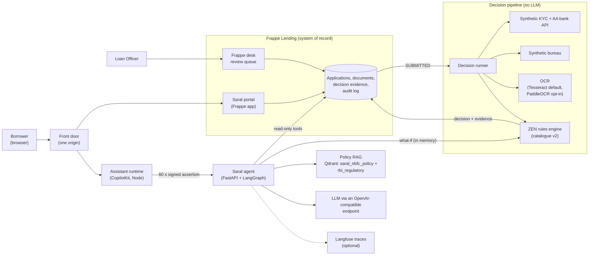

# Saral: a plain-language loan advisor

Saral helps people who applied for a personal loan understand the answer they got. It explains a decision in plain
English, Hindi or Telugu, says what the borrower can do next, and answers general policy questions with sources.

**Saral explains. It never decides.** Every decision comes from a deterministic rules engine (ZEN). The language
model only explains the decision that ZEN already recorded, and policy search (RAG) only supplies general, cited
background.

Built by Team Loan Rangers for the VaaniLabs.AI capstone (CBIT, AI/ML). The repository name is spelled
`Load-Advisory-Agent`. Who built what: [BUILD.md](BUILD.md).

> **Read this first**
> - **All applicant data is synthetic.** No real person, PAN, Aadhaar number, employer or bank account is used.
>   Synthetic PANs start `ZZ`, Aadhaar numbers start `9999`, and emails use `example.invalid`.
> - **The thresholds are a prototype, not a lender's policy.** They are labelled `prototype_synthetic`. The owner
>   approved the top ten for this prototype only (ADR-0011, 2026-11-04); the rest are approved as a batch (ADR-0009).
> - **Bajaj Finance Ltd is a public reference lender, not a partner.** Saral follows the public documents of one
>   NBFC, Bajaj Finance. Bajaj's published numbers are *indicative public guidance*; ZEN is the authority.
> - **Scope:** personal loans for salaried applicants only, in four purposes.

## Contents

- [What Saral does](#what-saral-does)
- [Architecture](#architecture)
- [The four products](#the-four-products)
- [ZEN decides, RAG explains](#zen-decides-rag-explains)
- [Languages](#languages)
- [How to run](#how-to-run)
- [Evaluation setup and results](#evaluation-setup-and-results)
- [Known limitations](#known-limitations)
- [Where things are](#where-things-are)

## What Saral does

| For | What happens |
|---|---|
| **Borrower** (Saral portal, served by Frappe) | Signs in, picks one of four loan purposes, fills a short form (7 steps, English), consents to a credit check, KYC and a bank-statement fetch, and uploads documents. Gets a decision card: outcome, amount, EMI and tenure. Can then chat with the Saral assistant. |
| **Saral assistant** (LangGraph agent) | Explains the recorded decision in one plain reason category, never a cut-off or a rule number. Suggests 2-3 general next steps. Runs up to 3 "what-if" estimates per session (amount, tenure, existing EMIs, income) that never change the application. Answers general policy questions with citations. Hands off to a person when asked. |
| **Loan Officer** (built-in Frappe desk) | Works the manual-review queue with internal reasons visible: Approve, Decline or Request info, with an audit trail (ADR-0008). |

Possible outcomes: approved, counter-offer (a smaller amount that passes, for example the ₹25 lakh cap), declined,
more information needed, and manual review. Fraud or list hits are never declined automatically; they go to a
person, and the borrower sees only "we couldn't verify some details".

## Architecture



Detailed diagrams (system, decision flow, agent turn, deployment) and the approach drawing:
[docs/saral/ARCHITECTURE.md](docs/saral/ARCHITECTURE.md). Older component diagrams:
[docs/architecture/](docs/architecture/README.md).

Main parts:

| Part | What it is | Where |
|---|---|---|
| Borrower portal | Frappe app `loan_advisory_portal`: Saral design, 3-stage apply flow, decision card, documents, assistant panel | `apps/loan_advisory_portal/` |
| Records | Frappe Lending doctypes for all 229 data-dictionary fields, a Decision Snapshot, an application state log | `apps/loan_advisory_portal/`, [docs/saral/LMS_DOCTYPES.md](docs/saral/LMS_DOCTYPES.md) |
| Decisions | ZEN Engine with the rule catalogue v2 (one JSON is the single source of truth) | `decision_engine/`, `contracts/catalogue_v2/`, [docs/saral/RULE_CATALOGUE_V2.md](docs/saral/RULE_CATALOGUE_V2.md) |
| Synthetic data services | KYC (PAN, Aadhaar), account-aggregator bank fetch, credit bureau. None of them is real | `ops/synthetic_kyc_bank/`, `apps/bureau/`, `synthetic_data/` |
| Documents | OCR for PAN, Aadhaar, salary slip, bank statement, employment letter; signature screening is a refer-only signal, never a verification | `apps/loan_advisory_portal/.../ocr/`, [docs/saral/OCR_BAKEOFF.md](docs/saral/OCR_BAKEOFF.md) |
| Agent | One LangGraph graph: classify, guard, fetch the recorded decision, explain / improve / what-if / policy / hand off, validate, sanitise | `apps/api/src/loan_advisory/agent/` |
| Explanation tone | Customer segmentation picks *how* to explain (Guided, Simple, Standard, Detailed), never *what* | `decision_engine/segmentation/` |
| Policy RAG | Two Qdrant collections: Bajaj documents (15 docs, 329 chunks) and RBI regulations (6 docs, 317 chunks); BM25 + EmbeddingGemma dense search, weighted RRF, optional reranker | `rag/`, `config/rag.yaml` |
| Observability | Self-hosted Langfuse (optional); message text is not exported unless switched on | `infra/langfuse/`, `docs/observability/` |

## The four products

All four are personal loans, grouped by purpose (ADR-0003). They share one flat prototype rate (20% a year, used for
sizing only) and a ₹25 lakh cap. A request above the cap gets a counter-offer at the largest amount that passes.
Bajaj Finance's personal-loan variants (Flexi Dropline, Flexi Hybrid) are not offered as products.

| Product | Amount | Tenure | Purpose document |
|---|---|---|---|
| Wedding (`PL_WEDDING`) | ₹40,000 to ₹25 lakh | 12 to 60 months | none required (invite or vendor quote optional) |
| Higher education (`PL_HIGHER_EDUCATION`) | ₹40,000 to ₹25 lakh | 12 to 84 months | admission letter or fee schedule |
| Home renovation (`PL_HOME_RENOVATION`) | ₹40,000 to ₹25 lakh | 12 to 84 months | contractor quote or property proof |
| Medical emergency (`PL_MEDICAL_EMERGENCY`) | ₹40,000 to ₹25 lakh | 12 to 60 months | hospital estimate or bill (priority review) |

Caps, tenures and the sizing rate are owner-approved for `prototype_synthetic` (ADR-0011). Purpose documents and
purpose fields are assumptions. Full matrix: [docs/saral/PRODUCT_MATRIX.md](docs/saral/PRODUCT_MATRIX.md).

Main prototype checks (ADR-0011): credit score floor 700; FOIR including the new EMI at most 0.50 (manual review above
0.45 for loans over ₹10 lakh); net income at least ₹25,001; at least ₹15,000 left each month after EMIs; 90+ days past
due in 24 months or a settlement / write-off in 24 months declines; 60+ days past due in 12 months goes to review.
**The borrower never sees these numbers.**

## ZEN decides, RAG explains

| | ZEN (decisions) | RAG (explanations) |
|---|---|---|
| Job | Decide approve / counter-offer / decline / more info / review, and size the offer | Give general, cited policy background |
| Source | `rule_catalogue.v2.json`, compiled to a ZEN decision model | Bajaj public documents and RBI directions, in two separate collections |
| Authority | The only authority (ADR-0001) | Indicative only; never tied to the applicant's own case |
| What the agent reads | The stored decision and its reason category, through a read-only tool (exact lookup, no search) | Retrieved passages, cited by source |
| Never | Uses an LLM | Indexes ZEN rules, or compares the applicant's values with a published number |

The agent has no write path. A what-if runs ZEN in memory, says only "would likely meet" or "wouldn't meet", is
capped at 3 per session (ADR-0010), and is labelled "Estimate only, your application is unchanged" (ADR-0005).

## Languages

- **Form:** English (ADR-0007).
- **Chat:** English, Hindi and Telugu, in native script or romanised. Replies come in the borrower's language.
- **Style:** answer first, at most three points, no internal terms, no cut-offs (ADR-0006). The segment from the
  borrower's bureau record only picks the explanation style; it is never shown to the borrower.

## How to run

Everything below uses synthetic data. **Never commit `.env`, secrets, `storage.sqlite` or trace files.**

### Decision core only (no Frappe, no network)

```bash
pip install -r requirements.txt -r requirements-test.txt
python -m contracts.catalogue_v2.build        # regenerate the catalogue docs from the contracts
python -m pytest contracts/tests tests -q     # unit tests (some suites need Frappe and skip without it)
```

### Synthetic data and services

```bash
# 200 synthetic applicants (deterministic seed)
python -m synthetic_data.saral_kyc_bank --count 200 --seed 20261103 --out /path/to/full200

# synthetic KYC + account-aggregator bank API, and the synthetic bureau (loopback only)
SARAL_SYNTH_DIR=/path/to/full200 python -m ops.synthetic_kyc_bank.app --port 8012
python -m ops.bureau_fixture_server --fixture /path/to/bureau_cases.json --port 8011
```

### Full integration stack

Frappe Lending, the Saral portal, Qdrant, the embedding service, the decision runner, the agent, the assistant
runtime and the front door. Hosts, ports, start order and health checks:
[docs/saral/INTEGRATION_DEPLOY.md](docs/saral/INTEGRATION_DEPLOY.md). Clean-clone install of Frappe and the portal:
[docs/development/setup.md](docs/development/setup.md). Every environment variable:
[docs/development/environment-variables.md](docs/development/environment-variables.md) and `.env.example`.

```bash
# decision runner: polls Frappe for SUBMITTED applications -> KYC/AA -> bureau -> ZEN -> evidence
SARAL_POLICY_VERSION=synthetic-v2 PYTHONPATH=.:apps/api/src:apps/bureau/src python -m ops.decision_runner

# agent (FastAPI + LangGraph); needs AGENT_ASSERTION_SECRET equal to the Frappe site's value
PYTHONPATH=.:apps/api/src python -m loan_advisory.agent.server --port 8095
```

The agent accepts only a 60-second signed assertion minted by Frappe. It cannot start a bureau enquiry or a decision.

The configuration and test tables from the previous README are kept in
[docs/development/developer-reference.md](docs/development/developer-reference.md).

## Evaluation setup and results

### Setup

| Item | Value |
|---|---|
| RAG golden set | Golden A v2: 227 questions (178 dev, 49 held out), EN/HI/TE, with refuse / abstain / clarify / conflict items. Drafted with an LLM, **human review pending** (PR #44) |
| Agent golden set | Golden B v1: 60 conversations (49 dev, 11 held out), salaried applicants plus 1-2 "outside what we offer" cases (PR #44) |
| Retrieval runs | Kaggle (2x T4), retrieval only: embedding, indexing, retrieval, reranking. No LLM runs on Kaggle |
| Generator and judge | Called through an OpenAI-compatible gateway: generator `claude-sonnet-4-6`, judge `gpt-6-luna`, fallback `gpt-5.6-terra` (every fallback use is recorded). The production model (`gpt-oss-120b` on Groq) is not the one evaluated |
| Framework | DeepEval 4.3.2: Faithfulness, AnswerRelevancy, ContextualRecall/Precision, RoleAdherence, ToolCorrectness, GEval rubrics; plus deterministic leak regexes |
| Live end to end | Real Chromium, recorded, against the integration build on the InstaBox test bed and the Frappe desk |
| Decision check | Re-decide all 200 synthetic applicants with catalogue v2 and compare with the dataset labels |
| Harness | `scripts/policy/eval_saral_*.py` and reports on PR #55; live E2E harness kept outside the repo |

Pass bars (ADR-0009): RAG faithfulness ≥ 0.85, answer relevancy ≥ 0.80, context recall ≥ 0.80; agent 0 leaks, role
adherence ≥ 0.90, tool correctness ≥ 0.95.

### Results

Labels: **automated** = scripted run, LLM-judged where a metric needs it, no human review. **GUI/live** = driven in
a real browser on the live stack and recorded. **blocked** = could not run; the reason is given.

| Area | Result | Label | Source |
|---|---|---|---|
| RAG, dev split (178), after fixes | Faithfulness 0.981, AnswerRelevancy 0.960, ContextualRecall 0.837 (all pass); 0/178 shown answers leak an internal term | automated | DEEPEVAL_BASELINE §11 (PR #55) |
| RAG, held-out (49) | {{RAG_HELDOUT}} | automated | {{RAG_HELDOUT_SOURCE}} |
| Agent, dev split (49 conversations, 158 turns) | First run 2026-11-04: leaks 22/158, RoleAdherence 0.464, tool correctness 0.456 (all fail). Re-run after the agent fixes: {{AGENT_EVAL_RESULTS}} | automated | AGENT_EVAL.md (PR #55) |
| Agent, held-out (11) | {{AGENT_HELDOUT}} | automated | {{AGENT_HELDOUT_SOURCE}} |
| Live E2E, GUI cases (59) | 55 pass, 3 fail, 1 blocked (no counter-offer accept action) | GUI/live | evidence REPORT (live E2E) |
| Live E2E, agent in the frontend (A5, 64 cases) | {{A5_TOTALS}} | GUI/live or blocked | {{A5_SOURCE}} |
| Decision label agreement (200 applicants) | 174/200 (87.0%) on 2026-11-04 03:50 IST; after the ZEN gap fixes: {{ZEN_AGREEMENT}} | automated (live API) | REDECIDE report |
| OCR bake-off (120 synthetic pages) | All fields exact: Tesseract 65.5%, PaddleOCR PP-OCRv5 mobile 75.5%; PAN 46% vs 100%. Final: {{OCR_BENCH}} | automated | [docs/saral/OCR_BAKEOFF.md](docs/saral/OCR_BAKEOFF.md) |
| Fast intent router (Laya, optional, off by default) | {{LAYA_BENCH}} | automated | {{LAYA_SOURCE}} |
| Langfuse trace review (7 cases) | 5 pass, 2 fail (counter-offer reason dropped; what-if cap not enforced) before the agent fixes | automated + manual reading | evidence/langfuse |

## Known limitations

Full list with counts, examples and a fix per item:
[project-management/AGENT_LIMITATIONS.md](project-management/AGENT_LIMITATIONS.md). The main ones:

- **Synthetic only.** Real documents, names and bureau files will behave differently. Nothing has run on real cases.
- **No human review of the eval sets or the judge.** Both golden sets were drafted with an LLM and await
  human review; judge-human agreement is not measured.
- **The judge and generator are stand-ins.** The production model was not evaluated; one judge vendor only.
- **Some decision inputs did not reach the rules** in the 2026-11-04 run (contract employment, residency, missing EMI
  debits, missing signature) and a bureau outage ended as an error. Status after the fixes: {{ZEN_GAP_STATUS}}.
- **Six catalogue rules were not compiled** (PL-074, 075, 079, 082, 099, 127). Status: {{ZEN_GAP_STATUS}}.
- **No counter-offer accept action** in the portal or the desk.
- **Test bed, not production.** Frappe runs on a test bench; the LLM gateway used in the evals ran on the owner's
  laptop and was a single point of failure; InstaBox sessions stop after 8 hours.
- **Hindi and Telugu samples are small** (9 hi and 11 te RAG dev items; 7 hi and 5 te agent conversations).

## Where things are

| Topic | Read |
|---|---|
| Architecture and approach drawing | [docs/saral/ARCHITECTURE.md](docs/saral/ARCHITECTURE.md) |
| Integration deployment | [docs/saral/INTEGRATION_DEPLOY.md](docs/saral/INTEGRATION_DEPLOY.md) |
| Rules, data and products | [RULE_CATALOGUE_V2](docs/saral/RULE_CATALOGUE_V2.md), [DATA_DICTIONARY](docs/saral/DATA_DICTIONARY.md), [PRODUCT_MATRIX](docs/saral/PRODUCT_MATRIX.md), [THRESHOLD_APPROVALS](docs/saral/THRESHOLD_APPROVALS.md) |
| What the borrower may be told | [docs/saral/REASON_DISCLOSURE_POLICY.md](docs/saral/REASON_DISCLOSURE_POLICY.md) |
| ZEN and RAG consistency | [docs/saral/ZEN_RAG_CONSISTENCY.md](docs/saral/ZEN_RAG_CONSISTENCY.md) |
| Synthetic datasets | [docs/saral/SYNTHETIC_DATASETS.md](docs/saral/SYNTHETIC_DATASETS.md) |
| Final numbers still to fill | [docs/saral/FINAL_NUMBERS.md](docs/saral/FINAL_NUMBERS.md) |
| Limitations | [project-management/AGENT_LIMITATIONS.md](project-management/AGENT_LIMITATIONS.md) |
| Earlier design rationale (pre-Saral) | [APPROACH.md](APPROACH.md) |
| Contributors | [BUILD.md](BUILD.md) |
