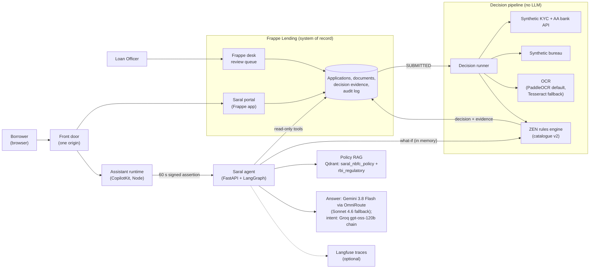

<p align="center">
  
</p>

<h3 align="center">Explains, never decides.</h3>

<p align="center">
  A plain-language loan advisor for personal-loan applicants, in English, Hindi and Telugu.
</p>

<p align="center">
  <a href="https://github.com/Narendarcodes/Load-Advisory-Agent/actions/workflows/ci.yml"></a>
  
  
  
</p>

<p align="center">
  <a href="docs/DEMO_GUIDE.md"><b>Demo</b></a> ·
  <a href="#run-it-locally"><b>Quickstart</b></a> ·
  <a href="#architecture"><b>Architecture</b></a> ·
  <a href="#evaluation-setup-and-results"><b>Evals</b></a> ·
  <a href="#where-things-are"><b>Docs</b></a>
</p>

## Demo video

<!-- VIDEO: unlisted link added after film -->
_Coming after the demo film is cut._ Until then, follow the 5-minute script in [docs/DEMO_GUIDE.md](docs/DEMO_GUIDE.md).

<!-- SCREENSHOTS: strip to be filled from evidence/recordings_20261104 (portal decision card, chat in EN/HI/TE, officer desk) -->
| Decision card | Assistant chat | Loan Officer desk |
|---|---|---|
| _screenshot to be added_ | _screenshot to be added_ | _screenshot to be added_ |

## About

Saral helps people who applied for a personal loan understand the answer they got. It explains a decision in plain
English, Hindi or Telugu, says what the borrower can do next, and answers general policy questions with sources.

**Saral explains. It never decides.** Every decision comes from a deterministic rules engine (ZEN). The language
model only explains the decision that ZEN already recorded, and policy search (RAG) only supplies general, cited
background.

Built by Team Loan Rangers for the VaaniLabs.AI capstone (CBIT, AI/ML). The repository name is spelled
`Load-Advisory-Agent`. Who built what: [BUILD.md](BUILD.md).

> **Read this first**
> - **All applicant data is synthetic.** No real person, PAN, Aadhaar number, employer or bank account is used.
>   Synthetic PANs start `ZZ`, Aadhaar numbers start with 0 or 1 (never issued by UIDAI), and emails use
>   `example.invalid`.
> - **The thresholds are a prototype, not a lender's policy.** They are labelled `prototype_synthetic`. The owner
>   approved the top ten for this prototype only (ADR-0011, 2026-11-04); the rest are approved as a batch (ADR-0009).
> - **Bajaj Finance Ltd is a public reference lender, not a partner.** Saral follows the public documents of one
>   NBFC, Bajaj Finance. Bajaj's published numbers are *indicative public guidance*; ZEN is the authority.
> - **Scope:** personal loans for salaried applicants only, in four purposes.

## Contents

- [What Saral does](#what-saral-does)
- [Run it locally](#run-it-locally)
- [Deployment options](#deployment-options)
- [Architecture](#architecture)
- [The four products](#the-four-products)
- [ZEN decides, RAG explains](#zen-decides-rag-explains)
- [Languages](#languages)
- [How to run (components)](#how-to-run-components)
- [Evaluation setup and results](#evaluation-setup-and-results)
- [Disclosures](#disclosures)
- [Known limitations](#known-limitations)
- [Future scope](#future-scope)
- [Where things are](#where-things-are)

## What Saral does

| For | What happens |
|---|---|
| **Borrower** (Saral portal, served by Frappe) | Signs in, picks one of four loan purposes, fills a short form (7 steps, English), consents to a credit check, KYC and a bank-statement fetch, and uploads documents. Gets a decision card: outcome, amount, EMI and tenure. Can then chat with the Saral assistant. |
| **Saral assistant** (LangGraph agent) | Explains the recorded decision in one plain reason category, never a cut-off or a rule number. Suggests 2-3 general next steps. Runs up to 3 "what-if" estimates per session (amount, tenure, existing EMIs, income) that never change the application. Answers general policy questions with citations. Hands off to a person when asked. |
| **Loan Officer** (built-in Frappe desk) | Works the manual-review queue with internal reasons visible: Approve, Decline or Request info, with an audit trail (ADR-0008). |

Possible outcomes: approved, counter-offer (a smaller amount that passes, for example the ₹25 lakh cap), declined,
more information needed, and manual review. Fraud or list hits are never declined automatically; they go to a
person, and the borrower sees only "we couldn't verify some details".

## Run it locally

This is the path for a laptop: a fresh clone, one `.env`, then start the pieces in order. Everything uses synthetic
data. **Never commit `.env`, secrets, `storage.sqlite`, trace exports or seeded login files.** The step-by-step Frappe
install (with the Windows pitfalls) is in [docs/development/setup.md](docs/development/setup.md); every variable is in
[docs/development/environment-variables.md](docs/development/environment-variables.md).

### Credentials and setup helper

Copy `.env.example` to `.env` and fill only these keys (names only; no value is ever committed):

| Key | Needed for | Required |
|---|---|---|
| `OMNIROUTE_BASE_URL`, `OMNIROUTE_API_KEY` (or `SARAL_LLM_BASE_URL` + `LLM_API_KEY` for any other OpenAI-compatible endpoint) | answer model | yes |
| `GROQ_API_KEY` | fast intent classifier | optional (falls back to the gateway, then rules) |
| `FRAPPE_API_KEY`, `FRAPPE_API_SECRET` | agent's read-only Frappe identity, created by the seeder | yes for the full stack |
| `AGENT_ASSERTION_SECRET`, `AGENT_SESSION_SECRET` | signed assertions and sessions (generate locally) | yes |
| `LANGFUSE_ENABLED`, `LANGFUSE_PUBLIC_KEY`, `LANGFUSE_SECRET_KEY`, `LANGFUSE_BASE_URL` | tracing | optional |

Demo logins (generated at run time, never committed), test applicants for each decision path and a presenter
script: [docs/DEMO_GUIDE.md](docs/DEMO_GUIDE.md).

### Prerequisites

| Tool | Version | Needed for |
|---|---|---|
| Git | any recent | clone |
| Python | 3.14 (CI and `pyproject.toml` target 3.14) | agent, decision core, synthetic services, tests |
| Node.js / npm | 24.x / 11.x | assistant runtime and the chat island build |
| Docker Desktop (Linux containers) with Compose v2 | recent | Frappe stack (MariaDB 11.8, Redis 8.6); optional Langfuse |
| RAM | 16 GB recommended | Frappe (about 4 GB), PaddleOCR (about 3 GB per worker), embeddings |
| An OpenAI-compatible LLM endpoint | — | answers. Default: an OmniRoute gateway serving `antigravity/gemini-3.8-flash` |
| Groq API key | optional | fast intent classifier; without it the classifier falls back to the gateway, then to rules |
| Hugging Face account | — | one-time `huggingface-cli login` for the gated EmbeddingGemma-2 model (policy search) |
| Git Bash (Windows) | Git for Windows 2.x | running the Frappe bootstrap scripts |
| cloudflared | optional | a temporary public URL for a demo (Deployment options) |

### 1. Clone and install

```bash
git clone https://github.com/Narendarcodes/Load-Advisory-Agent.git
cd Load-Advisory-Agent
python -m venv .venv
# Windows (PowerShell):  .venv\Scripts\Activate.ps1      Linux / macOS:  source .venv/bin/activate
python -m pip install --upgrade pip
pip install -r requirements.txt -r requirements-test.txt
pip install -r requirements-rag.txt                   # policy search with citations: CPU torch is fine on a laptop
python -m ruff check . && python -m pytest -q        # sanity check; live-service tests skip
```

Policy search embeds with EmbeddingGemma-2 (`google/embeddinggemma-2`), a gated Hugging Face model: run
`huggingface-cli login` and accept its licence once before the first run. Set `AGENT_RETRIEVER_DEVICE=cpu` on a
machine without a GPU. Ignore the "GPU container only" comment in `requirements-rag.txt`; the CPU wheel works.

### 2. Configure `.env`

```bash
cp .env.example .env        # Windows: copy .env.example .env
```

Fill these (names only here; values never go in git):

| Variable | Value |
|---|---|
| `AGENT_ASSERTION_SECRET` | 32+ random characters (`openssl rand -hex 32`). Must equal the Frappe site's `agent_assertion_secret` |
| `AGENT_SESSION_SECRET` | another `openssl rand -hex 32` |
| `SARAL_LLM_PROVIDER`, `SARAL_LLM_MODEL`, `SARAL_LLM_FALLBACK_MODEL` | defaults: `omniroute`, `antigravity/gemini-3.8-flash`, `antigravity/claude-sonnet-4-6@omniroute` |
| `OMNIROUTE_BASE_URL`, `OMNIROUTE_API_KEY` | your gateway, e.g. `http://127.0.0.1:20128/v1`. For any other OpenAI-compatible endpoint set `SARAL_LLM_BASE_URL` (or `LLM_BASE`) and `LLM_API_KEY` |
| `GROQ_API_KEY` | optional (intent classifier) |
| `FRAPPE_URL`, `FRAPPE_API_KEY`, `FRAPPE_API_SECRET` | after step 4: the read-only agent identity the seeder creates |
| `LOAN_POLICY_DIR`, `AGENT_RETRIEVER_DEVICE` | folder of the built policy index (step 6), and `cpu` without a GPU |
| `LANGFUSE_*` | optional; leave `LANGFUSE_ENABLED=0` for no telemetry |

**No service reads `.env` by itself.** Export the variables into the shell of each process you start (agent, decision
runner, runtime, synthetic services), in every new terminal: `set -a; . ./.env; set +a` (bash), or in PowerShell
`Get-Content .env | ? { $_ -match '^[A-Z_]+=' } | % { $k,$v = $_ -split '=',2; Set-Item "env:$k" ($v -replace '\s+#.*$','') }`.

### 3. Fastest check: the agent alone (no Docker, no Frappe)

```bash
PYTHONPATH=.:apps/api/src python -m loan_advisory.agent.server --offline --no-rag --port 8095
curl http://127.0.0.1:8095/healthz
```

`--offline` uses built-in synthetic records and in-memory evidence; `--no-rag` skips the retriever, so policy
questions abstain. This proves the LLM endpoint and the graph work before you bring up the rest.

### 4. Full stack

Start in this order (ports are the defaults; all bind to 127.0.0.1):

| # | Service | Command | Port |
|---|---|---|---:|
| 1 | Frappe Lending + Saral portal (Docker) | `docker compose -f infra/frappe/loanrangers.yml up -d --pull missing` (build the `loanrangers-frappe:16` image first if you have never built it, see [setup.md](docs/development/setup.md)); create the site: `docker exec loanrangers-backend-1 bash -lc 'cd /home/frappe/frappe-bench && bench new-site saral.local --mariadb-user-host-login-scope=% --db-root-password "$MYSQL_ROOT_PASSWORD" --admin-password "$ADMINPW" --install-app erpnext && bench --site saral.local install-app lending'` (about 6 min; pass both variables with `-e`; the root password is the db container's `MYSQL_ROOT_PASSWORD`); then `FRAPPE_SITE=saral.local FRAPPE_BACKEND=loanrangers-backend-1 bash infra/frappe/bootstrap/install_portal_app.sh`. The script copies the app into the backend container only: restart (or copy into) the queue and scheduler containers too. Put `agent_assertion_secret`, `allow_tests` and `allow_demo_users` into `sites/saral.local/site_config.json` by editing the file inside the container (exact command in [setup.md](docs/development/setup.md) §4), not with `bench set-config`, so the secret stays out of `logs/bench.log` (the `new-site` passwords are logged there too: treat that log as sensitive). For document-upload OCR use the `loanrangers-frappe:16-ocr` image (`infra/frappe/Dockerfile.ocr`, `infra/frappe/loanrangers.ocr.yml`); the seeded applicants do not need it | 8080 |
| 2 | Synthetic applicants (once) | `python -m synthetic_data.saral_kyc_bank --count 200 --seed 20261103 --out ../saral-data/full200` | — |
| 3 | Seed borrowers and applications (once) | `python -m ops.saral_seed.plan ../saral-data/full200 ../saral-data/plan.json`, then copy `plan.json` and `ops/saral_seed/frappe_seed.py` into the backend container and run it there (exact `docker cp` / `docker exec` lines at the top of `frappe_seed.py`). It writes logins and service keys to a 0600 `creds.json` and a `mapping.json`; copy both out, and put the reader key in `FRAPPE_API_KEY` / `FRAPPE_API_SECRET` | — |
| 4 | Synthetic KYC + AA bank API | `SARAL_SYNTH_DIR=../saral-data/full200 python -m ops.synthetic_kyc_bank.app --port 8012` | 8012 |
| 5 | Synthetic bureau | re-key the generated cases once: `python -c "from ops.saral_seed.plan import rekey_cli; rekey_cli('../saral-data/full200/bureau_cases.json', '../saral-data/mapping.json', '../saral-data/bureau_rekeyed.json')"`, then `python -m ops.bureau_fixture_server --fixture ../saral-data/bureau_rekeyed.json --port 8011` | 8011 |
| 6 | Policy index (once; needed for cited policy answers) | `python scripts/policy/fetch_sources.py` → `python scripts/policy/build_corpus_v3.py --src <src> --out <chunks>` → `python scripts/policy/index_corpus_v3.py --chunks <chunks> --qdrant-dir <qdrant>`. Then lay it out the way the agent reads it: for each collection (`saral_nbfc_policy`, `rbi_regulatory`) put `chunks.jsonl` in `$LOAN_POLICY_DIR/<collection>/` and move `<qdrant>/<collection>` to `$LOAN_POLICY_DIR/<collection>/qdrant_v2/`, and set `LOAN_POLICY_DIR` in `.env`. Keep it outside the repo (copyrighted texts are never committed). Some RBI PDFs must be downloaded in a browser into `$LOAN_POLICY_DIR/manual/` (see the script header) | embedded Qdrant |
| 7 | Decision runner | `SARAL_POLICY_VERSION=synthetic-v2 SARAL_BUREAU_URL=http://127.0.0.1:8011 SARAL_KYC_AA_URL=http://127.0.0.1:8012 PYTHONPATH=.:apps/api/src:apps/bureau/src python -m ops.decision_runner` | — |
| 8 | Saral agent | `PYTHONPATH=.:apps/api/src python -m loan_advisory.agent.server --port 8095` (add `--no-rag` if you skipped step 6) | 8095 |
| 9 | Assistant runtime | `cd apps/runtime && npm ci && npm run build && AGENT_AGUI_URL=http://127.0.0.1:8095/api/agui AGENT_RUNTIME_PORT=4200 FRAPPE_BASE_URL=http://127.0.0.1:8080 npm start` | 4200 |
| 10 | Chat island (once per change) | `cd apps/web/assistant && npm ci && npm run build` (writes into the portal app) | — |
| 11 | Demo Loan Officer (once) | with `allow_demo_users` in the site config (step 1), run `bench --site <site> execute loan_advisory_portal.setup_demo.create_demo_officer` inside the backend container; the password is printed once | — |

Then open **http://127.0.0.1:8080**, sign in with a seeded borrower from the 0600 logins file, and open the Saral
portal. Demo logins, the synthetic applicants to use for each decision path and a 5-minute presenter script:
**[docs/DEMO_GUIDE.md](docs/DEMO_GUIDE.md)**. The Loan Officer desk is at `/app` with the officer login. Health checks: `/healthz` on 8011, 8012 and 8095.

### Windows notes

- Use Docker Desktop with Linux containers and Compose v2 (`docker compose`).
- Set `git config core.autocrlf false` before cloning `frappe_docker` if you build the Frappe image yourself; CRLF in
  its shell scripts makes the containers restart-loop (see setup.md).
- Run the bootstrap scripts with **Git Bash explicitly** (`"C:\Program Files\Git\bin\bash.exe" -lc "..."`). The `bash`
  on PATH is often WSL's `C:\Windows\system32\bash.exe`, which has no docker CLI. The scripts are not executable in
  git, so always call them through `bash`.
- In PowerShell, set variables with `$env:NAME="value"` and use `;` instead of `&&` on older shells. `PYTHONPATH`
  uses `;` as separator on Windows: `$env:PYTHONPATH=".;apps/api/src"`.

## Deployment options

| Option | Status | Notes |
|---|---|---|
| Laptop + tunnel | **used for the submission** | The stack above on the owner's laptop, exposed through a temporary Cloudflare quick tunnel. The tunnel URL changes on every start and is never committed |
| Test bed (InstaBox + sandbox) | used for the live end-to-end test | [docs/saral/INTEGRATION_DEPLOY.md](docs/saral/INTEGRATION_DEPLOY.md) |
| Azure VM | future | One VM with Docker for Frappe, Qdrant and the services, a managed TLS front door, and the LLM gateway as a hosted endpoint with health checks |

## Architecture



Editable drawing (opens in draw.io): [docs/architecture.drawio.svg](docs/architecture.drawio.svg). Detailed
diagrams (system, decision flow, agent turn, deployment): [docs/saral/ARCHITECTURE.md](docs/saral/ARCHITECTURE.md).
Why it is built this way and what was reused: [APPROACH.md](APPROACH.md). Phases and dates:
[docs/build-plan.md](docs/build-plan.md). Older component diagrams:
[docs/architecture/](docs/architecture/README.md).

Main parts:

| Part | What it is | Where |
|---|---|---|
| Borrower portal | Frappe app `loan_advisory_portal`: Saral design, 3-stage apply flow, decision card, documents, assistant panel | `apps/loan_advisory_portal/` |
| Records | Frappe Lending doctypes for all 229 data-dictionary fields, a Decision Snapshot, an application state log | `apps/loan_advisory_portal/`, [docs/saral/LMS_DOCTYPES.md](docs/saral/LMS_DOCTYPES.md) |
| Decisions | ZEN Engine with the rule catalogue v2 (one JSON is the single source of truth) | `decision_engine/`, `contracts/catalogue_v2/`, [docs/saral/RULE_CATALOGUE_V2.md](docs/saral/RULE_CATALOGUE_V2.md) |
| Synthetic data services | KYC (PAN, Aadhaar), account-aggregator bank fetch, credit bureau. None of them is real | `ops/synthetic_kyc_bank/`, `apps/bureau/`, `synthetic_data/` |
| Documents | OCR for PAN, Aadhaar, salary slip, bank statement, employment letter: PaddleOCR PP-OCRv5 mobile by default, Tesseract as automatic fallback; signature screening is a refer-only signal, never a verification | `apps/loan_advisory_portal/.../ocr/`, [docs/saral/OCR_BAKEOFF.md](docs/saral/OCR_BAKEOFF.md) |
| Agent | One LangGraph graph: classify (Groq gpt-oss-120b → gpt-oss-20b → OmniRoute gemini-3.5-flash-lite → rules), guard, fetch the recorded decision only when the turn needs it, explain / improve / what-if / policy / clarify / hand off, validate, sanitise. Answers: Gemini 3.8 Flash via OmniRoute, Claude Sonnet 4.6 fallback | `apps/api/src/loan_advisory/agent/` |
| Explanation tone | Customer segmentation picks *how* to explain (Guided, Simple, Standard, Detailed), never *what* | `decision_engine/segmentation/` |
| Policy RAG | Two Qdrant collections: Bajaj documents (15 docs, 329 chunks) and RBI regulations (6 docs, 317 chunks); BM25 + EmbeddingGemma dense search, weighted RRF, optional reranker | `rag/`, `config/rag.yaml` |
| Observability | Self-hosted Langfuse (optional); message text is not exported unless switched on | `infra/langfuse/`, `docs/observability/` |

## The four products

All four are personal loans, grouped by purpose (ADR-0003). They share one flat prototype rate (20% a year, used for
sizing only) and a ₹25 lakh cap. A request above the cap gets a counter-offer at the largest amount that passes.
Bajaj Finance's personal-loan variants (Flexi Dropline, Flexi Hybrid) are not offered as products.

| Product | Amount | Tenure | Purpose document |
|---|---|---|---|
| Wedding (`PL_WEDDING`) | ₹40,000 to ₹25 lakh | 12 to 60 months | none required (invite or vendor quote optional) |
| Higher education (`PL_HIGHER_EDUCATION`) | ₹40,000 to ₹25 lakh | 12 to 84 months | admission letter or fee schedule |
| Home renovation (`PL_HOME_RENOVATION`) | ₹40,000 to ₹25 lakh | 12 to 84 months | contractor quote or property proof |
| Medical emergency (`PL_MEDICAL_EMERGENCY`) | ₹40,000 to ₹25 lakh | 12 to 60 months | hospital estimate or bill (priority review) |

Caps, tenures and the sizing rate are owner-approved for `prototype_synthetic` (ADR-0011). Purpose documents and
purpose fields are assumptions. Full matrix: [docs/saral/PRODUCT_MATRIX.md](docs/saral/PRODUCT_MATRIX.md).

Main prototype checks (ADR-0011): credit score floor 700; FOIR including the new EMI at most 0.50 (manual review above
0.45 for loans over ₹10 lakh); net income at least ₹25,001; at least ₹15,000 left each month after EMIs; 90+ days past
due in 24 months or a settlement / write-off in 24 months declines; 60+ days past due in 12 months goes to review.
**The borrower never sees these numbers.**

## ZEN decides, RAG explains

| | ZEN (decisions) | RAG (explanations) |
|---|---|---|
| Job | Decide approve / counter-offer / decline / more info / review, and size the offer | Give general, cited policy background |
| Source | `rule_catalogue.v2.json`, compiled to a ZEN decision model | Bajaj public documents and RBI directions, in two separate collections |
| Authority | The only authority (ADR-0001) | Indicative only; never tied to the applicant's own case |
| What the agent reads | The stored decision and its reason category, through a read-only tool (exact lookup, no search) | Retrieved passages, cited by source |
| Never | Uses an LLM | Indexes ZEN rules, or compares the applicant's values with a published number |

The agent has no write path. A what-if runs ZEN in memory, says only "would likely meet" or "wouldn't meet", is
capped at 3 per session (ADR-0010), and is labelled "Estimate only, your application is unchanged" (ADR-0005).

## Languages

- **Form:** English (ADR-0007).
- **Chat:** English, Hindi and Telugu, in native script or romanised. Replies come in the borrower's language.
- **Style:** answer first, at most three points, no internal terms, no cut-offs (ADR-0006). The segment from the
  borrower's bureau record only picks the explanation style; it is never shown to the borrower.

## How to run (components)

Everything below uses synthetic data. **Never commit `.env`, secrets, `storage.sqlite` or trace files.**

### Decision core only (no Frappe, no network)

```bash
pip install -r requirements.txt -r requirements-test.txt
python -m contracts.catalogue_v2.build        # regenerate the catalogue docs from the contracts
python -m pytest contracts/tests tests -q     # unit tests (some suites need Frappe and skip without it)
```

### Synthetic data and services

```bash
# 200 synthetic applicants (deterministic seed)
python -m synthetic_data.saral_kyc_bank --count 200 --seed 20261103 --out /path/to/full200

# synthetic KYC + account-aggregator bank API, and the synthetic bureau (loopback only)
SARAL_SYNTH_DIR=/path/to/full200 python -m ops.synthetic_kyc_bank.app --port 8012
python -m ops.bureau_fixture_server --fixture /path/to/bureau_cases.json --port 8011
```

### Full integration stack

Frappe Lending, the Saral portal, Qdrant, the embedding service, the decision runner, the agent, the assistant
runtime and the front door. Hosts, ports, start order and health checks:
[docs/saral/INTEGRATION_DEPLOY.md](docs/saral/INTEGRATION_DEPLOY.md). Clean-clone install of Frappe and the portal:
[docs/development/setup.md](docs/development/setup.md). Every environment variable:
[docs/development/environment-variables.md](docs/development/environment-variables.md) and `.env.example`.

```bash
# decision runner: polls Frappe for SUBMITTED applications -> KYC/AA -> bureau -> ZEN -> evidence
SARAL_POLICY_VERSION=synthetic-v2 PYTHONPATH=.:apps/api/src:apps/bureau/src python -m ops.decision_runner

# agent (FastAPI + LangGraph); needs AGENT_ASSERTION_SECRET equal to the Frappe site's value
PYTHONPATH=.:apps/api/src python -m loan_advisory.agent.server --port 8095
```

The agent accepts only a 60-second signed assertion minted by Frappe. It cannot start a bureau enquiry or a decision.

The configuration and test tables from the previous README are kept in
[docs/development/developer-reference.md](docs/development/developer-reference.md).

## Evaluation setup and results

### Setup

| Item | Value |
|---|---|
| RAG golden set | Golden A v2: 227 questions (178 dev, 49 held out), EN/HI/TE, with refuse / abstain / clarify / conflict items. Drafted with an LLM, **human review pending** (PR #44) |
| Agent golden set | Golden B v1: 60 conversations (49 dev, 11 held out), salaried applicants plus 1-2 "outside what we offer" cases (PR #44) |
| Retrieval runs | Kaggle (2x T4), retrieval only: embedding, indexing, retrieval, reranking. No LLM runs on Kaggle |
| Generator and judge | Final agent runs: generator `antigravity/gemini-3.8-flash` via OmniRoute (the shipped answer model; Sonnet 4.6 fallback, never used in the runs) and judge **the same model**, with `codex/gpt-6-luna` as judge fallback. RAG numbers are from the earlier run with generator `claude-sonnet-4-6` and judge `gpt-6-luna`. Intent classifier: the production Groq chain. See [Disclosures](#disclosures) |
| Framework | DeepEval 4.3.2: Faithfulness, AnswerRelevancy, ContextualRecall/Precision, RoleAdherence, ToolCorrectness, GEval rubrics; plus deterministic leak regexes |
| Live end to end | Real Chromium, recorded, against the integration build on the InstaBox test bed and the Frappe desk |
| Decision check | Re-decide all 200 synthetic applicants with catalogue v2 and compare with the dataset labels |
| Harness | `scripts/policy/eval_saral_*.py` and reports on PR #55; live E2E harness kept outside the repo |

Pass bars (ADR-0009): RAG faithfulness ≥ 0.85, answer relevancy ≥ 0.80, context recall ≥ 0.80; agent 0 leaks, role
adherence ≥ 0.90, tool correctness ≥ 0.95.

### Results

Labels: **automated** = scripted run, LLM-judged where a metric needs it, no human review. **GUI/live** = driven in
a real browser on the live stack and recorded. **blocked** = could not run; the reason is given.

| Area | Result | Label | Source |
|---|---|---|---|
| RAG, dev split (178), after fixes | Faithfulness 0.981, AnswerRelevancy 0.960, ContextualRecall 0.837 (all pass), ContextualPrecision 0.897; 0/178 shown answers leak an internal term; multi-hop recall 0.657 (weakest). Generator was `claude-sonnet-4-6`; **the shipped Gemini 3.8 Flash was not RAG-evaluated** | automated | DEEPEVAL_BASELINE §11 (PR #55), [docs/saral/FINAL_EVAL_20261104.md](docs/saral/FINAL_EVAL_20261104.md) §4 |
| RAG, held-out (49) | Not run (owner decision 2026-11-04 14:49 IST: no new RAG eval) | blocked | [docs/saral/FINAL_EVAL_20261104.md](docs/saral/FINAL_EVAL_20261104.md) §4 |
| Agent, dev split (49 conversations, 158 turns) | First run 2026-11-04: leaks 22/158, RoleAdherence 0.464, tool correctness 0.456 (all fail). **Final (Gemini 3.8 Flash generator and judge): no-leak 48/49 conversations, leak turns 1/158, role adherence 0.680, tool correctness exact 0.835 / lenient 0.937, expected behaviour pass@0.5 0.658: every bar fails.** Superseded River DeepSeek run: 48/49, role 0.695, exact 0.867, lenient 0.951 | automated | [docs/saral/FINAL_EVAL_20261104.md](docs/saral/FINAL_EVAL_20261104.md) §2 |
| Agent, held-out (11) | Single run, 11 conversations / 33 turns: no-leak 10/11 (AC-014 quotes Bajaj's public 650 guidance the question asks for; strict regex), role adherence 0.750, tool exact 0.788 / lenient 0.909, pass@0.5 0.697: every bar fails. Held-out ids were visible to reviewers in the golden review sheet from 07:42 IST | automated | [docs/saral/FINAL_EVAL_20261104.md](docs/saral/FINAL_EVAL_20261104.md) §3 |
| Live E2E, GUI cases (59) | 55 pass, 3 fail, 1 blocked (no counter-offer accept action) | GUI/live | evidence REPORT (live E2E) |
| Live E2E, agent in the frontend (A5, 64 cases) | Full 64-case run on the owner's laptop from `main` @ 658ce44, 2026-11-04. **Harness labels: 41 pass, 17 fail, 6 blocked.** After reading every failing answer: **51 pass, 7 real fails, 6 blocked** (10 harness fails were harness false positives: the Sources card's P1–P5 labels hit the old citation selector and leak regex, "cut-off" inside a correct refusal was flagged as a leak, and "Approved" was on the card, not in the answer text). No real leak. Real fails: POL-02-EN, POL-05-EN (agent timeout, "busy" fallback); POL-09-TE, POL-10-TE (abstained, no citations); CLAR-HI (what-if error instead of a clarifying question); EXP-REVIEW-HI, EXP-REVIEW-TE (answered in English). Blocked = Q-03 (tenure and loan-amount what-ifs in HI/TE; no 3-what-if cap in HI/TE). Applicants: SYN-APP-0098 replaces 0087 (portal refuses requests above ₹25L); the 0031 decline cases ran as EN 0031 / HI 0002 / TE 0003 | GUI/live (harness) + manual review | evidence REPORT_A5_LAPTOP (A5 laptop run, 2026-11-04) |
| Decision label agreement (200 applicants) | 174/200 (87.0%) on 2026-11-04 03:50 IST; after the ZEN gap fixes: 187/200 offline, 188/200 with the owner's SYN-APP-0131 ruling, plus 12 owner-accepted design choices; 0 open defects | automated (live API, then offline) | REDECIDE reports, [docs/saral/FINAL_EVAL_20261104.md](docs/saral/FINAL_EVAL_20261104.md) §7 |
| OCR (120 synthetic pages; then 46 public sample documents / 184 pages) | Synthetic, all fields exact: Tesseract 65.5%, PaddleOCR 75.5%. Public samples, all fields, Tesseract vs PaddleOCR: PAN 4% vs 58%, Aadhaar 62% vs 98%, bank statement 6% vs 48%, payslip 51% vs 79%; Paddle median 0.52 s, p90 5.96 s per page; single annotator; six sources have no licence, so images are internal only. PaddleOCR is the default | automated | [docs/saral/OCR_BAKEOFF.md](docs/saral/OCR_BAKEOFF.md) |
| Intent classifier (140 dev turns) | Groq gpt-oss-120b 135/140 (96.4%), 0 over budget, vs OmniRoute Sonnet 116/140 (82.9%) with 88 timeouts | automated | [docs/saral/FINAL_EVAL_20261104.md](docs/saral/FINAL_EVAL_20261104.md) §5 |
| Fast intent router (Laya, optional, off by default) | Fine-tuned hybrid 84.3% vs 82.9% (+1.4; gate needed +2.0): failed, router off | automated | [docs/saral/FINAL_EVAL_20261104.md](docs/saral/FINAL_EVAL_20261104.md) §6, `project-management/LAYA_ROUTER.md` |
| Langfuse trace review (7 cases) | 5 pass, 2 fail (counter-offer reason dropped; what-if cap not enforced) before the agent fixes | automated + manual reading | evidence/langfuse |

## Disclosures

Read these before quoting any number from this repository.

- **Self-grading bias.** In the final agent runs Gemini 3.8 Flash is both the answer generator and the judge. A model
  judging its own answers tends to score them higher. The deterministic numbers (leaks, tool exact match) do not
  depend on the judge. When the Gemini judge failed, `codex/gpt-6-luna` scored the row, and those rows are counted
  (35 of 256 dev rows; 5 of 110 held-out judge calls).
- **Superseded runs.** Earlier runs with River (generator DeepSeek-V4.1-Flash, judge Kimi-K3) are superseded: River
  returned HTTP 402 from about 12:58 IST on 2026-11-04. They are shown only for comparison.
- **RAG numbers are not from the shipped model.** The reported RAG dev numbers come from the earlier Sonnet-generated
  run. The Gemini RAG run was stopped by the owner (14:49 IST) and nothing from it is reported. The RAG held-out split
  was not run. A partial River RAG run (not final) had one strict word-list hit (R2-KYC-03 quotes Bajaj's public KYC
  consent text containing "retrieve").
- **Held-out exposure.** The 11 held-out conversation ids were visible to reviewers in the golden review sheet from
  07:42 IST; the held-out agent run was done once, afterwards, with no tuning on it.
- **Public-figure leak flags.** The one leak turn in each agent split (AC-009 in dev, AC-014 in held-out) quotes a
  public Bajaj figure that the golden answer asks for. The strict regex counts it; it is not tied to the applicant.
- **Gateway and tunnel.** The OmniRoute gateway runs on the owner's laptop. Its Tailscale Funnel address returned 502,
  so the evals reached it through a temporary Cloudflare quick tunnel, set only in local environment files. The
  gateway was down several times on 2026-11-04 (about 02:18, 11:00–11:20 and 11:55–12:03 IST).
- **Groq free tier.** 33 dev turns hit Groq's per-minute limit on `gpt-oss-120b` and were classified by `gpt-oss-20b`.
- **Hindi and Telugu what-if errors.** Apart from "out of range" and "not a number", what-if errors in Hindi and Telugu
  show one generic sentence, and the error frame sentence is in English (owner deprioritised, 10:55 IST).
- **What-if scope.** The what-if accepts amount, tenure, existing EMIs and income (Q-03); score and job months are
  refused. On a catalogue-v2 decision an estimate that cannot be computed is shown as "couldn't be estimated", never
  as "would not meet" (Q-23, owner approved 10:07 IST).
- **Rules switched on by owner decision.** PL-013 (at most 2 employer changes in 24 months) and PL-016 (permanent
  employment only) are active on all four products; the owner's "if everything is green it is ok to merge" was taken
  as approval (inferred). PL-130 (resident only) applies to home renovation only.
- **Group B labels.** SYN-APP-0118 and SYN-APP-0131 are DECLINE by owner decision (10:38 IST); 0131's dataset label
  is superseded, the dataset itself is not edited. Twelve catalogue design differences were accepted as intended.
- **Tracing gaps.** Langfuse instrumentation gaps 2, 3, 6, 9 and 10 are still open (no sanitiser span, no input-guard
  span, retriever logs ids not text, identity check before the trace starts, panels empty with content capture off).
- **Tests.** One sandbox test fails (a proxy-environment test); 1,849 passed on the
  integration build at 10:51 IST.

## Known limitations

Full list with counts, examples and a fix per item:
[project-management/AGENT_LIMITATIONS.md](project-management/AGENT_LIMITATIONS.md). The main ones:

- **Synthetic only.** Real documents, names and bureau files will behave differently. Nothing has run on real cases.
- **No human review of the eval sets or the judge.** Both golden sets were drafted with an LLM and await
  human review; judge-human agreement is not measured.
- **The judge grades its own model.** Gemini 3.8 Flash is both the answer generator and the judge in the final agent
  runs (self-grading bias); RAG numbers come from an earlier Sonnet-generated run. See [Disclosures](#disclosures).
- **Some decision inputs did not reach the rules** in the 2026-11-04 03:50 run (contract employment, residency, missing EMI
  debits, missing signature) and a bureau outage ended as an error. Fixed (D-11 to D-15) on #56, merged to `main` 2026-11-04.
- **Six catalogue rules were not compiled** in that run (PL-074, 075, 079, 082, 099, 127). Compiled on #56, merged to `main` 2026-11-04.
- **Every agent bar fails** on dev and held-out (role adherence 0.68 / 0.75 vs 0.90; tool exact 0.835 / 0.788 vs 0.95).
- **No counter-offer accept action** in the portal or the desk.
- **Test bed, not production.** Frappe runs on a test bench; the LLM gateway used in the evals ran on the owner's
  laptop and was a single point of failure; InstaBox sessions stop after 8 hours.
- **Hindi and Telugu samples are small** (9 hi and 11 te RAG dev items; 7 hi and 5 te agent conversations).

## Future scope

- **Laya intent router.** Fine-tune on the prepared 1,027-row EN/HI/TE set, refit the per-intent thresholds,
  re-benchmark against the Groq classifier, then wire it in front of the classifier (#57 ships flag-off).
- **River generator return.** Re-run the River DeepSeek generator (and a second judge family) once the account is
  funded, to cross-check the self-graded Gemini numbers.
- **Azure deployment.** Move from laptop + tunnel to an Azure VM with a stable TLS endpoint and a hosted LLM gateway
  with health checks.
- **Multi-hop RAG.** Per-collection retrieval slots and query decomposition for multi-hop questions (recall 0.657),
  plus more multi-hop golden items; run the RAG held-out split on the shipped model.
- **Agent quality to the bars.** Policy-turn tool routing, role adherence on improve and leak-probe turns, and
  a human-reviewed golden set and judge calibration.

## Where things are

| Topic | Read |
|---|---|
| Architecture and approach drawing | [docs/saral/ARCHITECTURE.md](docs/saral/ARCHITECTURE.md) |
| Integration deployment | [docs/saral/INTEGRATION_DEPLOY.md](docs/saral/INTEGRATION_DEPLOY.md) |
| Rules, data and products | [RULE_CATALOGUE_V2](docs/saral/RULE_CATALOGUE_V2.md), [DATA_DICTIONARY](docs/saral/DATA_DICTIONARY.md), [PRODUCT_MATRIX](docs/saral/PRODUCT_MATRIX.md), [THRESHOLD_APPROVALS](docs/saral/THRESHOLD_APPROVALS.md) |
| What the borrower may be told | [docs/saral/REASON_DISCLOSURE_POLICY.md](docs/saral/REASON_DISCLOSURE_POLICY.md) |
| ZEN and RAG consistency | [docs/saral/ZEN_RAG_CONSISTENCY.md](docs/saral/ZEN_RAG_CONSISTENCY.md) |
| Synthetic datasets | [docs/saral/SYNTHETIC_DATASETS.md](docs/saral/SYNTHETIC_DATASETS.md) |
| Functional document (problem, domain, interventions, user journey, tech construct) | [docs/functional.md](docs/functional.md) |
| Demo logins, test applicants, presenter script | [docs/DEMO_GUIDE.md](docs/DEMO_GUIDE.md) |
| Final evaluation numbers | [docs/saral/FINAL_EVAL_20261104.md](docs/saral/FINAL_EVAL_20261104.md) |
| Editable architecture drawing | [docs/architecture.drawio.svg](docs/architecture.drawio.svg) |
| Build plan (phases, dates, owners) | [docs/build-plan.md](docs/build-plan.md) |
| Limitations | [project-management/AGENT_LIMITATIONS.md](project-management/AGENT_LIMITATIONS.md) |
| Approach: who it is for, build vs reuse, architecture | [APPROACH.md](APPROACH.md) |
| Contributors | [BUILD.md](BUILD.md) |
