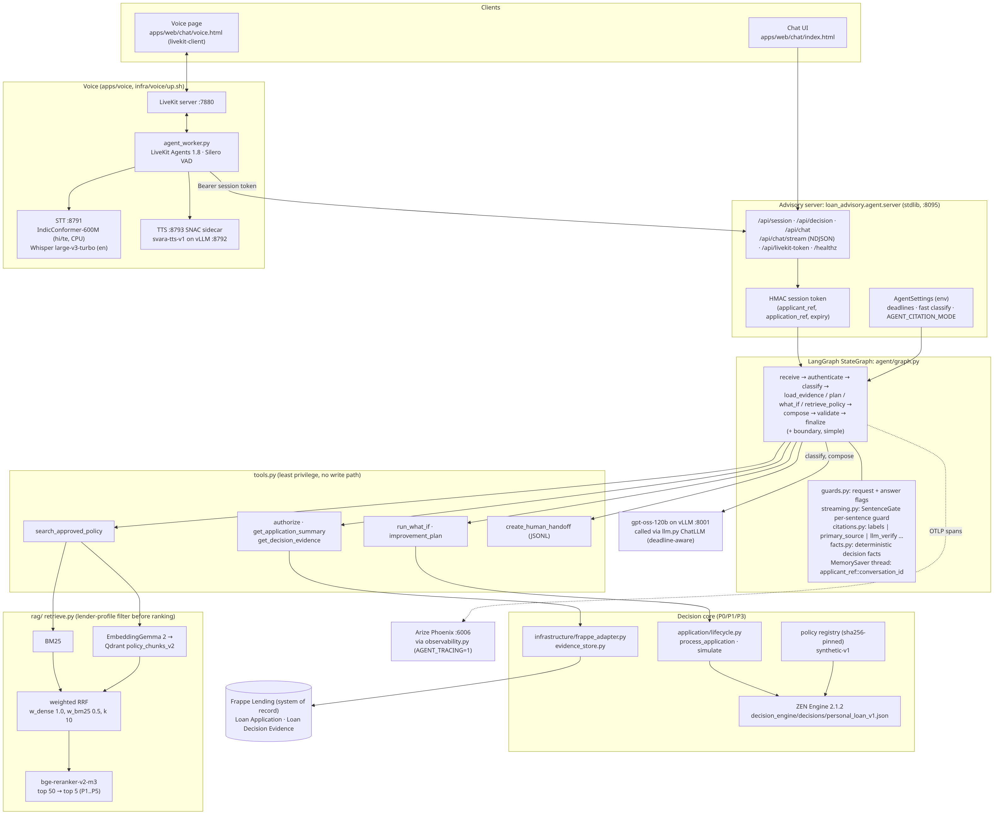
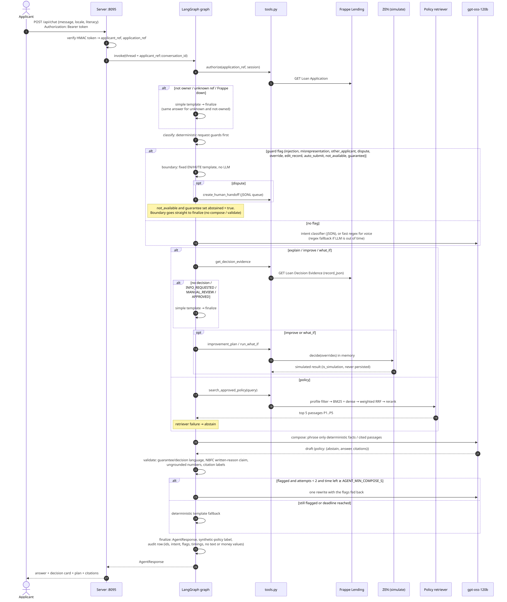
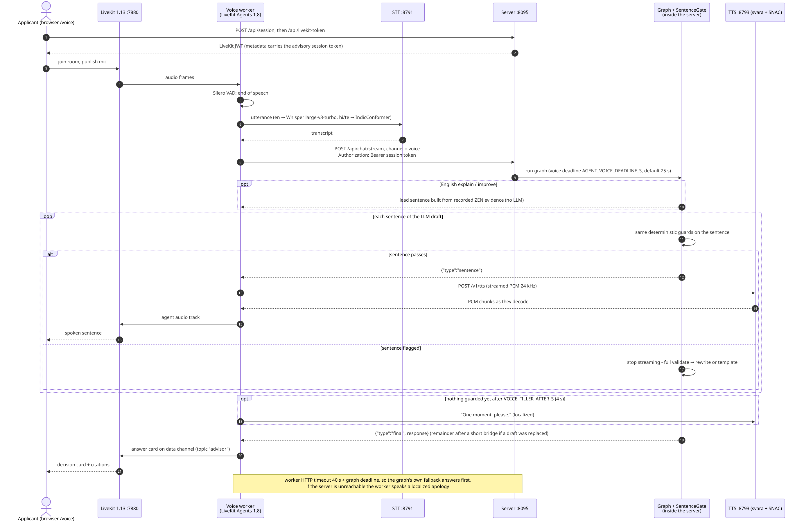
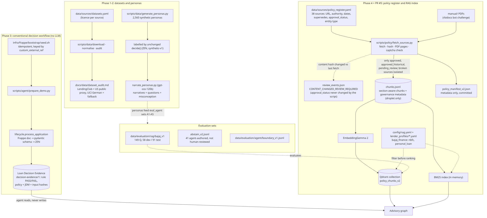

# Architecture

Mermaid sources live in [`diagrams/`](diagrams/) next to their rendered SVG and PNG (re-render with
`bash docs/architecture/diagrams/render.sh`). Every box and arrow is taken from the code on `feat/abstain-unavailable`
(PR #10). Other docs here: [conventional-workflow.md](conventional-workflow.md) (Phase 3 decision workflow) and
[repository-structure.md](repository-structure.md) (P1-era layout notes). Rationale is in [../../APPROACH.md](../../APPROACH.md).

All applicant data and the four thresholds are synthetic (`synthetic-v1`). Bajaj Finance is a public reference lender,
not a partner.

## 1. System context

Who and what the agent talks to. Everything is self-hosted and bound to 127.0.0.1 on the droplet.

Source: [01-system-context.mmd](diagrams/01-system-context.mmd) · [SVG](diagrams/01-system-context.svg)

## 2. Components

The advisory server, the LangGraph graph and its helpers, the least-privilege tools, the decision core, the policy
retriever (Qdrant + BM25 + reranker), Frappe, the gpt-oss LLM and the LiveKit voice stack (STT/TTS).

Source: [02-components.mmd](diagrams/02-components.mmd) · [SVG](diagrams/02-components.svg)

## 3. Agent request sequence

One text turn, including the authorization, guard (boundary), simple-template, abstain and rewrite/fallback paths.

Source: [03-agent-request-sequence.mmd](diagrams/03-agent-request-sequence.mmd) · [SVG](diagrams/03-agent-request-sequence.svg)

## 4. Voice turn sequence

One voice turn: VAD, STT, the same graph via `/api/chat/stream`, sentence-by-sentence guarding and TTS, the filler and
the timeout relationship.

Source: [04-voice-turn-sequence.mmd](diagrams/04-voice-turn-sequence.mmd) · [SVG](diagrams/04-voice-turn-sequence.svg)

## 5. Data and policy ingestion

Offline paths: dataset audit and synthetic personas, the conventional decision workflow that writes Decision Evidence,
and the policy register → fetch → chunks → Qdrant/BM25 index, plus the evaluation sets.

Source: [05-data-policy-ingestion.mmd](diagrams/05-data-policy-ingestion.mmd) · [SVG](diagrams/05-data-policy-ingestion.svg)
