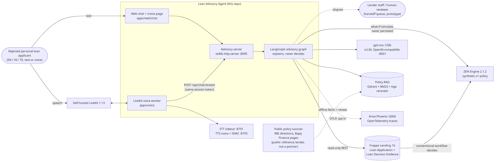
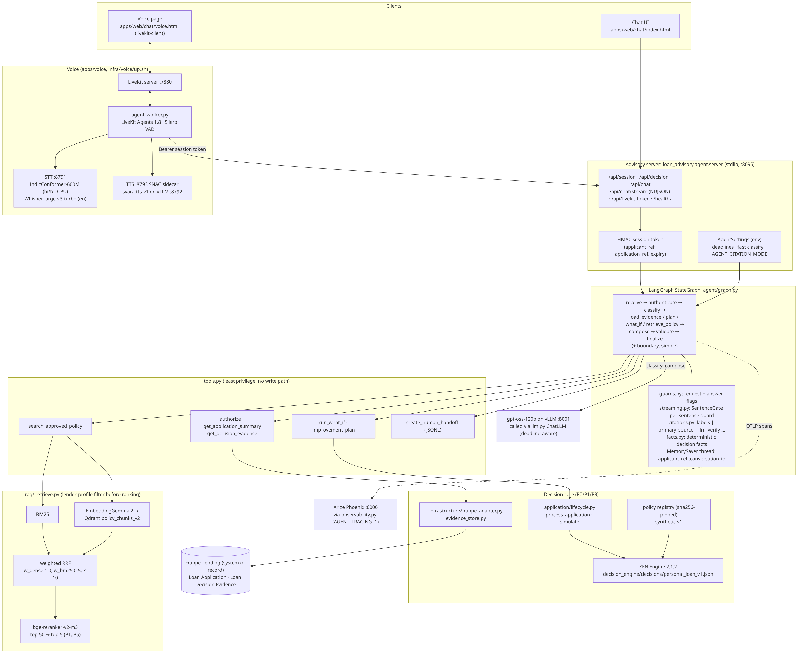
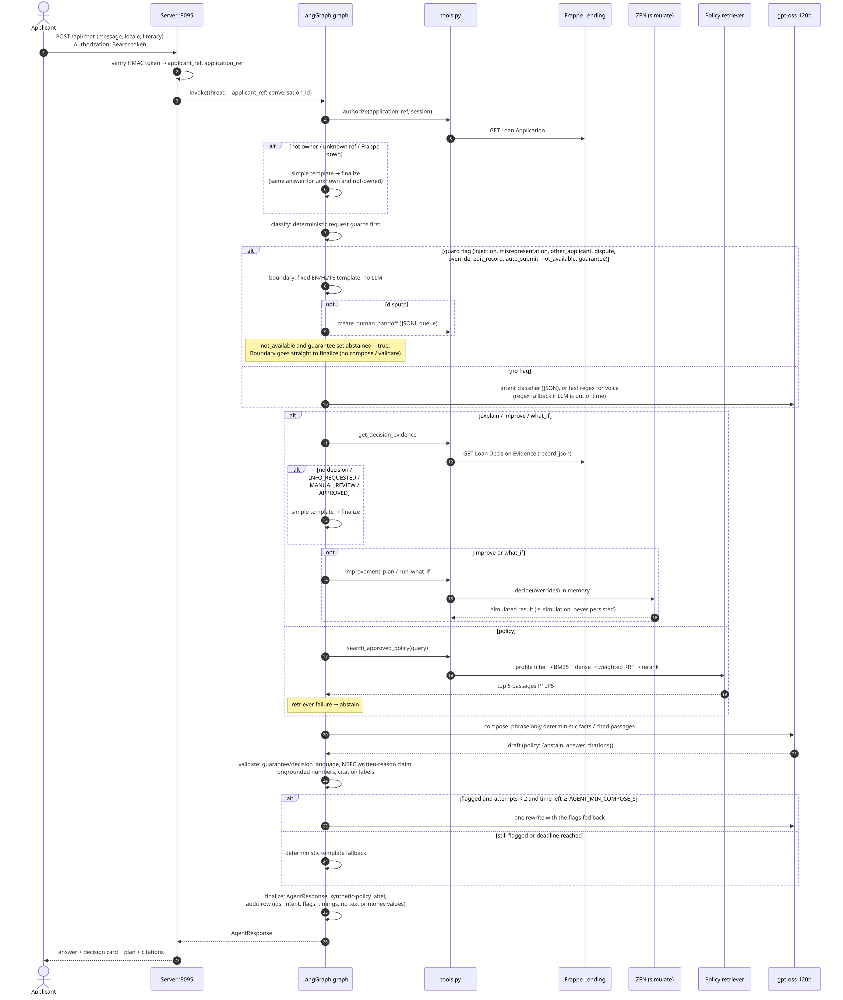
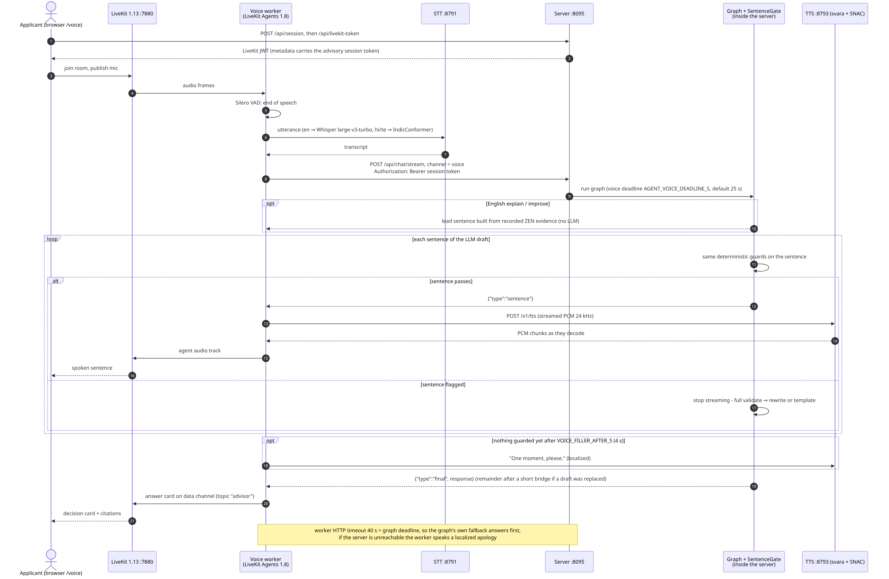
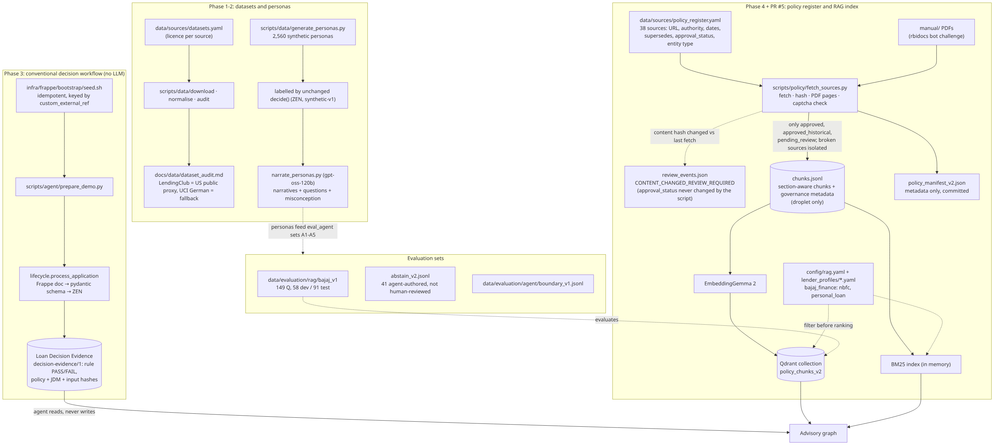

# Architecture

Mermaid sources live in [`diagrams/`](diagrams/) next to their rendered SVG and PNG (re-render with
`bash docs/architecture/diagrams/render.sh`). The revised diagrams (01, 02, 05) were checked against `main` at
`9a6e3f6` (2026-10-27), so they cover the bureau entry point (PR #17) and optional Langfuse export (PR #18) as well
as the advisory agent; 03 and 04 keep their PR #10 scope. Other docs here:
[synthetic-bureau.md](synthetic-bureau.md) (bureau flow, `REVIEW` vs `ERROR`, score precedence),
[conventional-workflow.md](conventional-workflow.md) (Phase 3 decision workflow) and
[repository-structure.md](repository-structure.md) (layout notes), plus
[hardening-baseline.md](hardening-baseline.md) (verified HEAD, P0 merge chain, roadmap status). Rationale is in
[../../APPROACH.md](../../APPROACH.md), observability in [../observability/langfuse.md](../observability/langfuse.md).

All applicant data and the four thresholds are synthetic (`synthetic-v1`). Bajaj Finance is a public reference lender,
not a partner. The synthetic bureau is a development-only FastAPI service, not CIBIL/FICO.

## Migration documentation (Frappe platform)

The diagrams below describe the **agent runtime** and are unchanged by the migration. The borrower platform, its
boundaries and its test plan are documented separately:

| Document | Covers |
| --- | --- |
| [frappe-borrower-platform.md](frappe-borrower-platform.md) | systems of record, routes, rendering contract, identity/roles, lifecycle, deployment topology, failure modes |
| [fastapi-agent-boundary.md](fastapi-agent-boundary.md) | what stays in FastAPI, the assertion contract, trust rules |
| [assertion-security-and-scaling.md](assertion-security-and-scaling.md) | single-use replay (Redis `SET NX EX`), fail-closed behaviour, multi-worker deployment |
| [loan-lifecycle-mapping.md](loan-lifecycle-mapping.md) | canonical `loan-lifecycle/1` states, native ↔ portal adapters, atomic transitions, audit log, reconciliation |
| [rate-limits.md](rate-limits.md) | per-account portal budgets, per-`sub` agent budgets, shared store and fail-closed behaviour |
| [copilotkit-agui-integration.md](copilotkit-agui-integration.md) | runtime → FastAPI identity bridge and AG-UI streaming |
| [livekit-integration.md](livekit-integration.md) | voice token minting in Frappe and the worker gap |
| [../migration/frappe-screen-inventory.md](../migration/frappe-screen-inventory.md) | legacy screen → Frappe destination |
| [../migration/screen-completion-matrix.md](../migration/screen-completion-matrix.md) | every borrower screen: route, purpose, data, permissions, validation, states, acceptance and owner-deferred gaps |
| [../migration/fastapi-endpoint-migration-matrix.md](../migration/fastapi-endpoint-migration-matrix.md) | every legacy endpoint, where it goes |
| [../migration/frappe-lending-doctype-mapping.md](../migration/frappe-lending-doctype-mapping.md) | Lending doctypes, custom fields, ownership |
| [../development/frappe-disposable-environment.md](../development/frappe-disposable-environment.md) | isolated site, commands, secrets, failure modes |
| [../testing/borrower-platform-test-plan.md](../testing/borrower-platform-test-plan.md) | Suite map and Addenda G/H: current-run 169 Frappe, 683 host (15 skipped), 13 runtime and 34 island tests, 36 journeys, 39 security checks |
| [../testing/responsive-accessibility-performance.md](../testing/responsive-accessibility-performance.md) | Phase E measurements: reflow at six widths, axe scans, keyboard/tap-target checks, Shiki/voice lazy-load |
| [../testing/production-readiness.md](../testing/production-readiness.md) | Phase F evidence: production-like proxy checks, two-worker Redis state, bounded load, deployment contract and residual risks; §9 Phase H confirmation |
| [../audit/frappe-implementation-audit.md](../audit/frappe-implementation-audit.md) | Independent audit findings, mapped to phases, with post-audit status per phase |
| [../audit/frappe-hardening-report.md](../audit/frappe-hardening-report.md) | Ten-section consolidation of the hardening campaign, labelled verified / test-only / unverified, with the current-run regression record |

## 1. System context

Who and what the agent talks to. Everything is self-hosted and bound to 127.0.0.1 on the droplet. The advisory server
is FastAPI (`apps/api/src/loan_advisory/api/`); the synthetic bureau is a separate FastAPI service. `/api/bureau/run`
evaluates the signed-in application through that bureau and the data-quality gates, then the unchanged ZEN decision.
The diagrams predate the migration and show the legacy bearer credential; the agent endpoints themselves are unchanged.

> Post-migration, the borrower-facing routes in this section belong to Frappe. The agent endpoints
> (`/api/agui`, `/api/chat`, `/api/chat/stream`, `/api/bureau/run`, `/healthz`) remain; the rest is retired.
> See the migration documents above.

Source: [01-system-context.mmd](diagrams/01-system-context.mmd) · [SVG](diagrams/01-system-context.svg)

## 2. Components

The advisory server and its bureau entry point, the LangGraph graph and its helpers, the least-privilege tools, the
decision core, the bureau data-quality gates, the policy retriever (Qdrant + BM25 + reranker), Frappe, the gpt-oss LLM,
the optional Phoenix/Langfuse exporters and the LiveKit voice stack (STT/TTS).

Source: [02-components.mmd](diagrams/02-components.mmd) · [SVG](diagrams/02-components.svg)

## 3. Agent request sequence

One text turn, including the authorization, guard (boundary), simple-template, abstain and rewrite/fallback paths.

Source: [03-agent-request-sequence.mmd](diagrams/03-agent-request-sequence.mmd) · [SVG](diagrams/03-agent-request-sequence.svg)

## 4. Voice turn sequence

One voice turn: VAD, STT, the same graph via `/api/chat/stream`, sentence-by-sentence guarding and TTS, the filler and
the timeout relationship.

Source: [04-voice-turn-sequence.mmd](diagrams/04-voice-turn-sequence.mmd) · [SVG](diagrams/04-voice-turn-sequence.svg)

## 5. Data and policy ingestion

Offline paths: dataset audit and synthetic personas, the conventional decision workflow that writes Decision Evidence,
the synthetic-bureau fixture generator and its 120-case replay, the policy register → fetch → chunks → Qdrant/BM25
index, plus the evaluation sets.

Source: [05-data-policy-ingestion.mmd](diagrams/05-data-policy-ingestion.mmd) · [SVG](diagrams/05-data-policy-ingestion.svg)

## 6–11. Borrower platform diagrams (added by the reproducibility audit)

Sections 1–5 predate the Frappe migration and describe the agent runtime. The six diagrams below describe the
**platform as it is actually implemented now** — every node, DocType, field name, route and port in them was read out
of the code in the clean clone, not from a proposal. They are shipped as Mermaid source plus rendered SVG; unlike 01–05
there is no PNG twin yet, so reference the SVG.

| # | Diagram | What it pins down |
|---|---|---|
| 6 | [Entity model](diagrams/06-entity-model.svg) · [source](diagrams/06-entity-model.mmd) | The 11 real `loan_advisory_portal` DocTypes and their links to Customer / Lending doctypes, with the actual field names (`custom_lifecycle_state`, `custom_latest_evidence`, `consent_at`, `turn_count`, `secret_hash`, `is_simulation`) |
| 7 | [Infrastructure / deployment](diagrams/07-infrastructure-deployment.svg) · [source](diagrams/07-infrastructure-deployment.mmd) | Compose services and volumes, ports :8001/:8080/:8081, the Nginx acceptance proxy, the Node runtime (:4200), the agent (:8095), the stub (:8096), the synthetic bureau (:8011) and Langfuse (:3000) — with development-only surfaces marked as such |
| 8 | [Borrower application sequence](diagrams/08-borrower-application-sequence.svg) · [source](diagrams/08-borrower-application-sequence.mmd) | Login → start → save → consent gate → submit → decision presentation → document download, exactly as `tests/e2e/portal_journeys.py` exercises it |
| 9 | [Decision engine flow](diagrams/09-decision-engine-flow.svg) · [source](diagrams/09-decision-engine-flow.mmd) | Frappe application → canonical schema → ZEN 2.1.2 rules → rule-level PASS/FAIL evidence → the stored decision the agent is only allowed to explain. The LLM appears nowhere on the decision path |
| 10 | [Consent lifecycle](diagrams/10-consent-lifecycle.svg) · [source](diagrams/10-consent-lifecycle.mmd) | First consent, unchanged consent, profile update, new consent version, revocation, re-consent and the timestamp the controller restamps on every save |
| 11 | [Authentication and authorization](diagrams/11-authentication-authorization.svg) · [source](diagrams/11-authentication-authorization.mmd) | Frappe session → 60-second HMAC assertion minted by the site → runtime boundary → agent verification → single-use `jti` → borrower ownership and conversation isolation. The browser has no edge to the agent |

Di 6–11 were rendered with `npx @mermaid-js/mermaid-cli@11` (same invocation as
[`diagrams/render.sh`](diagrams/render.sh)); each file was re-read after rendering to confirm the labels and arrows
match the code. The status of 01–05 against the post-migration implementation — and the exact edit needed to bring
them current — is recorded in [../reproducibility/diagram-inventory.md](../reproducibility/diagram-inventory.md).
