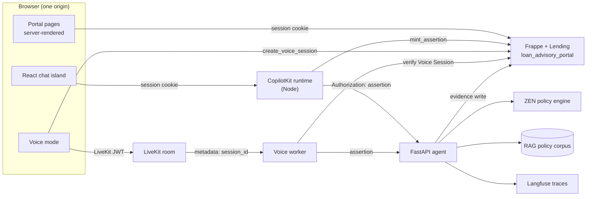
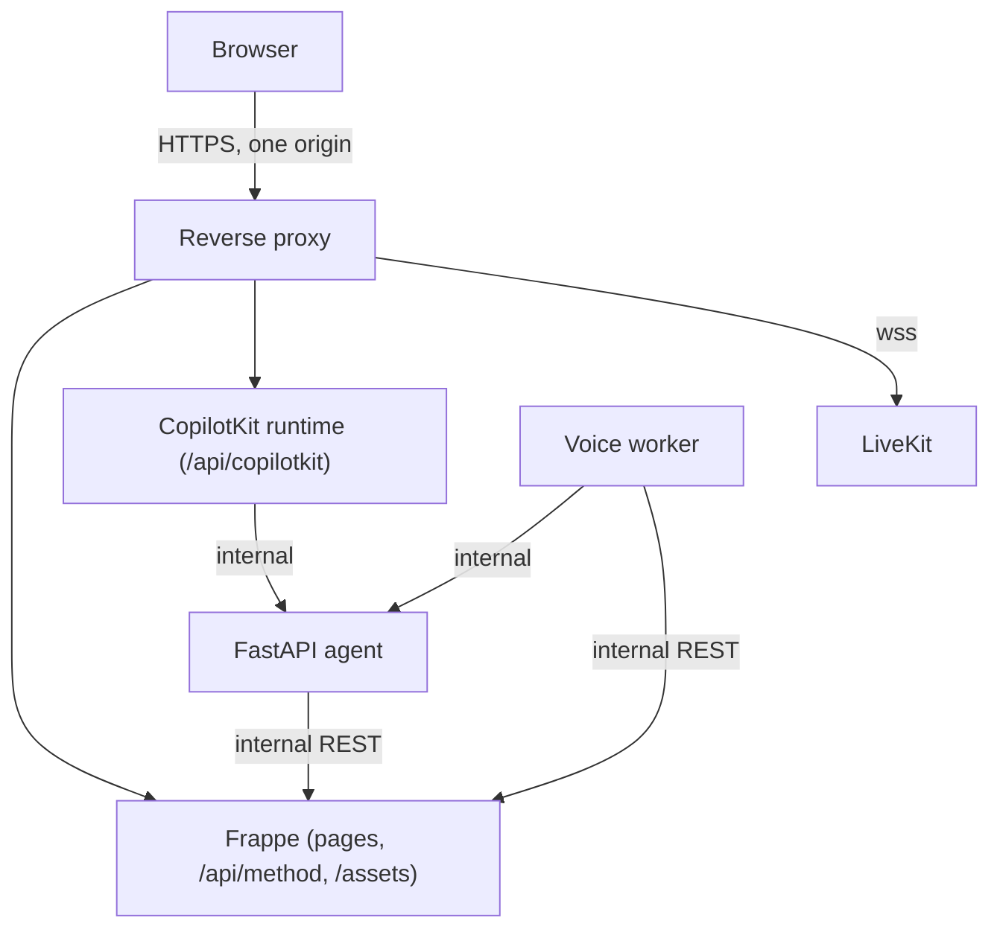

# Frappe borrower platform

Status: **implemented and verified on the disposable site** (`loanportal.local`), except where a section is marked *proposed* or *unresolved*.

Scope: the borrower-facing web stack runs on Frappe Framework + Frappe Lending. FastAPI is kept only as the AI-agent backend (see [fastapi-agent-boundary.md](fastapi-agent-boundary.md)). CopilotKit/AG-UI and LiveKit are preserved and are documented separately.

## System context

### Systems of record

| Data | Owner | Not the owner |
| --- | --- | --- |
| Users, accounts, invitations | Frappe (`User`, `Borrower Profile`, `Customer`, `Account Invitation`) | FastAPI |
| Applications, documents, lifecycle | Frappe Lending (`Loan Application`, `File`) | FastAPI |
| Decision record | computed by the agent (ZEN + policy corpus), **stored** in Frappe `Loan Decision Evidence` | neither side alone: the engine computes, Frappe keeps the audit row |
| Policy corpus and its version | agent service (`rag/`, `policy_version`, `policy_sha256`) | Frappe stores only the version string |
| Conversation ownership | Frappe `Advisory Conversation` | FastAPI checkpointer (transient) |
| Voice authorisation | Frappe `Voice Session` | worker, LiveKit |
| Traces | Langfuse | Frappe, portal |

### Database ownership

| Store | Holds | Written by |
| --- | --- | --- |
| MariaDB (`loanportal.local` / production site DB) | all Frappe doctypes above | Frappe only |
| Redis cache | session cache, selected application (`sha256(sid)`, 4 h) | Frappe |
| Redis queue + scheduler | background jobs | Frappe |
| RAG index / vector store | policy chunks, embeddings | agent build pipeline |
| Langfuse Postgres + ClickHouse | traces, scores | agent service |

No service writes into another service's store. The agent reaches Frappe only through its own credentials (`Agent Integration` role, evidence + voice-session read) and through Frappe REST.

### Request flows

| Flow | Path |
| --- | --- |
| Page load | browser → Frappe website route → `get_context` → Jinja base layout → bootstrap island → whitelisted JSON calls |
| Mutating action | page script → `frappe.call` (session cookie + CSRF) → whitelisted method → `borrower_context()`/`owned_application()` → doctype write |
| Chat turn | island → runtime → `mint_assertion` → FastAPI `/api/agui` → LangGraph/ZEN → evidence write → AG-UI stream back |
| Voice turn | voice mode → `create_voice_session` → LiveKit join → worker exchanges the `Voice Session` for an assertion → FastAPI `/api/chat/stream` → LiveKit audio + transcript |

### Streaming flows

| Stream | Protocol | Notes |
| --- | --- | --- |
| Chat | AG-UI over SSE | `RUN_STARTED → TEXT_MESSAGE_START → sentence deltas → STATE_SNAPSHOT → TEXT_MESSAGE_END → RUN_FINISHED`; snapshot is an allowlist |
| Voice agent → advisory | NDJSON (`/api/chat/stream`) | one line per guarded sentence, then the final response |
| Voice transcript | LiveKit data channel topic `advisor` | audio never leaves the room; turn log omits transcripts |

### Failure modes

| Failure | Borrower sees | System behaviour |
| --- | --- | --- |
| Frappe/site down | 5xx / connection error | nothing else can work; no partial writes |
| Assertion secret missing (<32 chars) | agent request fails closed | `ServiceUnavailable` 503; no unsigned fallback |
| Runtime cannot mint | island error, recoverable | run refused; no unauthenticated call is attempted |
| FastAPI down | chat/voice error | portal pages, applications and documents keep working |
| Evidence write fails | decision card `{available:false}` | application state intact; no fabricated decision |
| Redis down | selection lost | `SelectionRequired` 409; the borrower re-selects |
| LiveKit config missing | voice unavailable | `create_voice_session` → 503; text chat unaffected |
| Voice worker cannot verify the row | call refused | metadata is treated as untrusted input |
| Agent provider error | `provider_error: true` in the decision projection | retry path stays with the agent |

### Deployment topology

- Production is same-origin HTTPS: the Frappe session cookie must reach the runtime path, so the island is served from the Frappe host, not a separate dev origin.
- FastAPI and the voice worker are never browser-reachable.
- LiveKit is public only as `wss` through the proxy.
- The disposable development site violates this on purpose: it has no published port and is reached only from inside the container (see [frappe-disposable-environment.md](../development/frappe-disposable-environment.md)).

## Versions in play

| Component | Version | Evidence |
| --- | --- | --- |
| Frappe Framework | 16.51.0 | container image `loanrangers-frappe:16`, `bench version` |
| ERPNext | 16.50.0 | same image |
| Frappe Lending | 16.6.1 | `apps/lending` inside the bench |
| bench | 5.31.0 | bench CLI |
| Python | 3.14 | `env/bin/python` |
| App | `loan_advisory_portal` (module *Loan Advisory Portal*) | `apps/loan_advisory_portal` |

### Compatibility verification (Phase 2)

| Pair | Versions | Verdict |
| --- | --- | --- |
| Frappe ↔ Lending | 16.51.0 ↔ 16.6.1 (both `version-16`) | compatible; `Loan Application`, `Loan Product`, `Loan Document Type` and the `documents` child table were introspected on the site, not assumed |
| ERPNext ↔ Lending | 16.50.0 ↔ 16.6.1 | compatible; Lending declares ERPNext as a dependency and the app installed cleanly |
| Portal app ↔ Frappe | 0.1.0 ↔ 16.51.0 | compatible; 87 integration tests, no use of removed APIs |
| Frappe site ↔ FastAPI | Python 3.14.8, pydantic ≥2, langgraph 1.2.x, FastAPI ≥0.139 | no shared process or venv: the portal app has no third-party Python deps, so there is no resolver conflict |
| CopilotKit runtime ↔ Node | `@copilotkit/runtime` 1.83.0, `@ag-ui/client` 1.0.2, host Node 24.18 | compatible; gateway uses `node:http` and `createCopilotNodeListener`; no Node in the backend image, which only matters for building, not serving |
| AG-UI JS ↔ Python | `@ag-ui/client` 1.0.2 ↔ `ag-ui-protocol` 1.0.0 | major-compatible; the Python side encodes events itself (`api/events.py`), so the wire contract is stable |
| LiveKit server ↔ worker | server 1.13, Python `livekit-agents` (unpinned, in `hx-loan-agent`) | works today; **not pinned** — see the risk below |
| LiveKit browser client | `livekit-client@2` from jsDelivr (unpinned) | works today; **not pinned** and not integrity-checked — see the risk below |
| CopilotKit React | `@copilotkit/react-core` 1.83.0, React 19.2 | compatible with the runtime 1.83.0 |

Material risks and the least disruptive fixes:

1. **Unpinned LiveKit client asset.** `apps/web/chat/voice.html:7` loads `livekit-client@2` from a CDN, so a minor release can change behaviour without a commit, and there is no SRI hash. Fix: pin an exact version, self-host it under `public/`, and add SRI if it stays external. Deferred to Phase 6/7 because the voice page is being rebuilt inside the island.
2. **Unpinned Python LiveKit agents.** The worker image installs `livekit-agents[silero]` without a lock in this repo. Fix: record the resolved version in `infra/voice/up.sh` (or a constraints file); the worker port is done, but the version it runs against is still unrecorded.
3. **Python 3.14 for the worker.** `livekit-agents` support for 3.14 is not verified. The worker runs in a separate container, so the portal's Python 3.14 is not a constraint; the worker should stay on the Python version its image pins.
4. **No shared origin yet.** Frappe (site cookie) and the runtime must share an origin for the island; the runtime currently allows exactly the configured Frappe origin and mints one assertion per run, but the disposable site's dev server does not proxy `/api/copilotkit`, so the proxy is still part of the deployment.

## Routing

Pages are Frappe website routes: `apps/loan_advisory_portal/loan_advisory_portal/www/<path>.html` plus a sibling `.py` that exposes `get_context`.

| Route | Template | Controller | Access |
| --- | --- | --- | --- |
| `/borrower` | `www/borrower/index.html` | `index.py` | signed-in borrower |
| `/borrower/apply` | `www/borrower/apply.html` | `apply.py` | signed-in borrower |
| `/borrower/application?name=<ref>` | `www/borrower/application.html` | `application.py` | owner only; foreign/unknown id → 404 card |
| `/borrower/profile` | `www/borrower/profile.html` | `profile.py` | signed-in borrower |
| `/borrower/feedback` | `www/borrower/feedback.html` | `feedback.py` | signed-in borrower |
| `/borrower/assistant?application=<ref>` | `www/borrower/assistant.html` | `assistant.py` | owner only; foreign/unknown id → 404 card; no selection → chooser |
| `/borrower/invite?token=<token>` | `www/borrower/invite.html` | `invite.py` | guest only; signed-in visitors redirect to `/borrower` |
| `/borrower/help` | `www/borrower/help.html` | `help.py` | public (guest and any account) |
| `/borrower/products` | `www/borrower/products.html` | `products.py` | public; reads the enabled `Loan Product` catalogue |
| `/borrower/terms` | `www/borrower/terms.html` | `terms.py` | public; versioned notice |
| `/borrower/privacy` | `www/borrower/privacy.html` | `privacy.py` | public; versioned notice |

`get_website_user_home_page` (`portal/routing.py:4`) sends users holding `Loan Borrower` to `/borrower` after login, so `/login` lands borrowers in the portal while other users keep the default.

### Rendering contract (verified against Frappe 16 source, not guessed)

- A page is wrapped in a base layout **only when its own source contains ``** (or the context carries `base_template`). `base_template_path` alone does not wrap; Frappe's `set_properties_from_source` auto-wraps only the `context.base_template` case. Every page template therefore starts with ``.
- Each controller sets `no_cache = 1` and `base_template_path = "templates/portal/base.html"`, and returns a **dict** — `self.context.update(data)` replaces the object, so `context.attr = ...` on the return value raises `AttributeError`. Pages assign with `context["key"] = ...`.
- Redirects are `frappe.flags.redirect_location = url` followed by `raise frappe.Redirect(302)`; Frappe answers 302 with `Location`.
- `context.http_status_code` is honoured by the renderer, which is how the 404 card keeps the correct status while still rendering the layout.

## Design system and shell

`public/css/portal.css` carries the design tokens (ink/mute/line, accent `#1f5eff`, pass/fail/warn palettes, radii, shadow, font stack with Telugu/Devanagari fallbacks), components (cards, badges, buttons, fields, alerts, tables, timeline, steps, assistant placeholder) and a reduced-motion block. `templates/portal/base.html` is the only layout: skip link, sticky header with brand and conditional nav, `main#main` (`tabindex="-1"` so the skip link moves focus), footer disclaimer ("Loan Advisory explains your options. A person makes the final decision.") with links to help, products, terms and privacy, and a `#flash` live region.

Phase E measured the rendered portal: no horizontal overflow at 390×844, 768×1024, 1024×768, 1360×900, 1920×1080 or 320×640; 20 axe-core scans with no violations; skip link, focus order, tap targets and 200% text checked by hand. The record and its limitations are in [responsive-accessibility-performance.md](../testing/responsive-accessibility-performance.md).

The shell is server-rendered and static; all user data is fetched from whitelisted JSON methods by page scripts in `public/js/pages/`. The assistant page is the one exception: its content is a React island (`apps/web/assistant`) that talks to the CopilotKit gateway instead of the JSON methods.

- Bootstrap island: `` built by `portal/jinja.py:6` (`user`, `csrf_token`, and for borrowers `customer`, `literacy`, `locale`, `profile`). `tojson` is Jinja's HTML-escaping filter, not `frappe.as_json`.
- Client runtime: `public/js/portal.js` exposes `Portal.call`, `Portal.upload`, formatting helpers, `lifecycleBadge`, `flash`, `logout`. Failures redirect to `/login?redirect-to=` only on 401 or on 403 with `exc_type == "PermissionError"`.
- Assistant island: `apps/web/assistant` is built with `npm run build` into `public/js/assistant/` (`assistant.js`, `assistant.css`, `chunks/`); `assistant.html` links the CSS in its head block and loads the JS as a module. The build is committed output — the backend image has no Node, so Frappe only serves the files. The page's own `#assistant-context` script carries `application`, `csrf_token`, `literacy`, `locale` and `voice: {enabled, consent_version}`; the island reads nothing else from the DOM. The LiveKit SDK is a lazy chunk loaded only when a call starts. The Shiki grammar chunks are lazy too; the Streamdown/Shiki markdown renderer itself is eager (measured in Phase E, [responsive-accessibility-performance.md](../testing/responsive-accessibility-performance.md)).
- Preference vocabulary: `config/borrower_preferences.json` (schema `borrower-preferences/1`) is the one table of locales (`en | hi | te`) and literacy levels (`low | medium | high`) — the agent's own vocabulary — with aliases for legacy rows. Its byte-identical vendored copy is loaded by `portal/preferences.py`; the profile page, `api/profile.py` validation, `portal/identity.py`/`services/assertion.py` claims and the `Borrower Profile` Select options all read it, and `tests/test_preference_vocabulary.py` fails on drift.

## Identity, roles and permissions

- **Session**: Frappe's own session cookie. Guests hitting `/borrower*` get a 302 to `/login?redirect-to=<path>` (`portal/pages.py:29`).
- **Role**: `Loan Borrower` (created by `install.py:ensure_roles`, `desk_access = 0`). Borrowers hold no Desk permissions on Lending DocTypes; all access goes through whitelisted methods that re-check ownership.
- **Profile link**: `Borrower Profile` (one per User) points at a `Customer`; `Customer.portal_users` remains authoritative when it has entries (`portal/identity.py:70`).
- **Context**: `borrower_context()` (`portal/identity.py:37`) returns `user`, `customer`, `profile`, `literacy`, `locale` and raises typed errors for guest, disabled user, missing role, missing profile, inactive profile, missing/disabled customer, and a broken `portal_users` link.
- **Ownership**: `owned_application()` (`portal/identity.py:81`) returns the row only when `applicant_type == "Customer"` and `applicant == ctx.customer`; otherwise `NotFound` — a foreign id is indistinguishable from a missing one (verified: 404 API, 404 page with the friendly card).
- **Selection**: the "selected application" used by agent/voice flows is a cache value keyed by `sha256(sid)` with a 4-hour TTL (`portal/identity.py:118-141`), so it cannot leak across sessions.
- **Sign-out mirror**: disabling a User suspends its `Borrower Profile` via the `User.on_update` doc event (`hooks.py:24`, `identity.py:144`).

## CSRF

Authenticated sessions must send `X-Frappe-CSRF-Token` on every POST. The token is generated by `frappe.sessions.get_csrf_token()` and published in the bootstrap island; `portal.js` reads it from there. Guest POSTs (invitation validate/redeem) are CSRF-exempt because guest sessions have no saved token, which is Frappe's documented behaviour and was verified with curl.

## Security boundaries (B4)

- **No generic DocType access for feedback.** `Borrower Feedback` has no `Loan Borrower` DocPerm. The only write path is `api/feedback.py:submit_feedback`, which sets `user`/`customer` from `borrower_context()` and validates rating, category, length and application ownership; the controller repeats the category and application-link checks for any privileged writer. A direct REST create/read is a `PermissionError`, pinned by `test_borrowers_have_no_direct_doctype_access`.
- **Master data is borrower-scoped too.** `list_document_types` calls `borrower_context()`; a guest, a role-less website user and a borrower without a profile are refused (`test_document_types_require_a_borrower`).
- **Invitation tokens do not stay in the URL.** `invite.js` reads the token once and calls `history.replaceState` before the first request; the page also sends `Referrer-Policy: no-referrer`. The token remains single-use (unique redemption row), hashed at rest, expiring and revocable (`tests/test_invitations.py`).
- **Identity comes from the session or the verified assertion, never the payload or a header.** A table-driven matrix calls every borrower method as a guest (401), as a signed-in account without the role (403), and against another borrower's application id (404); it also fails if a new whitelisted method appears without being listed (`tests/test_authorization_matrix.py`). FastAPI ignores `X-Forwarded-User`, `X-Frappe-Session`, `X-Customer`, `X-Application` and `Host` both without an assertion (401) and alongside a valid one (claims unchanged) (`tests/test_agent_guards.py`).
- **Response headers.** `portal/headers.py` (`hooks.py:after_request`) adds `nosniff`, `no-referrer`, `SAMEORIGIN` and a permissions policy to every non-Desk response, a strict CSP to `/borrower*` only (`script-src 'self' blob:`, no inline script or eval), and HSTS when the request is TLS. Desk (`/app`) is untouched. `Retry-After` is copied onto 429s. Pinned by `tests/test_response_headers.py`.
- **Rate limits and provider budgets.** Per-account fixed windows on the portal methods and per-`sub` budgets on the agent routes; tables, store semantics and fail-closed behaviour are in [rate-limits.md](rate-limits.md).
- **Proxy pinning is tested, production ingress is not built.** The in-repo harness overwrites `Host` and `X-Frappe-Site-Name` with `loanportal.local`, replaces `X-Forwarded-For` and never forwards a client site selector; `tests/test_proxy_boundary.py` reads the config as text and asserts it. A production reverse proxy that terminates TLS, forwards cookies/CSRF and disables buffering for SSE remains Phase F (F-P03).

## Conversation identity and history (B5)

- **Identity is the verified assertion.** The browser never names a user, customer or application that
  the server trusts. `mint_assertion` derives all of them from `borrower_context()`, resolves the
  application through `owned_application` or the cached selection, and refuses to mint without one
  (`SelectionRequired`). The gateway forwards only `Authorization: Bearer <assertion>` to FastAPI.
- **A thread is bound once.** `_touch_conversation` (`api/agent.py:67`) creates an `Advisory
  Conversation` with `user`, `customer` and `application` fixed. A thread owned by another account is
  `Forbidden`; re-using one for a different application is `Conflict` — there is no silent rebinding
  (F-S03). A relinked profile cannot keep old threads because ownership is re-checked on every read.
- **The run must use the asserted thread.** AG-UI rejects a run whose `threadId` differs from the
  assertion's `thread` claim (403, `api/agui.py:44`); `/api/chat` and `/api/chat/stream` do the same
  for a body `conversation_id` (`require_conversation`, `api/routes_agent.py:41`) (F-S04/F-Z04).
- **The transcript is owned server-side.** `record_turn` appends the question and answer to the
  `messages` child table (`Advisory Message`: role, text), trims to 200 rows, advances `turn_count`,
  sets the title from the first question and refreshes `last_activity`. `conversation_messages`
  returns the last 100 rows only after an ownership check; a foreign or unknown thread is `NotFound`
  (F-M02/F-D04/F-U01/F-U02).
- **The island restores, never guesses.** Thread ids are stored per `user + application`, so a
  different borrower on a shared browser never inherits a thread. On load the island adopts the
  remembered thread only for this account and application and replays the server transcript without
  re-running the agent; a 404 restores nothing, a 401 returns to sign-in. Switching application loads
  that application's thread (or a fresh one), so no prompt or history crosses over. A `RUN_ERROR`
  naming another application or account starts a new thread instead of retrying (identity change,
  logout/expiry and switching all fail closed).
- **Refusals keep their status.** The gateway mints inside the run (`apps/runtime/src/gateway.ts:205`),
  so a Frappe 403/404/409/503 arrives as a `RUN_ERROR` such as `HTTP 409: This conversation is linked
  to another application.` A missing cookie/CSRF header is the only path that becomes a genuine 401.
  Only the installed `@agui/client` `HttpAgent.fetch` and CopilotKit runtime factory are used; there
  is no parallel transport or client-side ownership decision.

Tests: `tests/test_agent_bridge.py` (16), `tests/test_assistant_page.py` (8),
`tests/test_authorization_matrix.py` (8, including `conversation_messages`),
`tests/test_agent_api.py` (14), `tests/test_agent_guards.py` (7) and the island suites (34). The
fastest full picture is the current-run Phase H totals: `Frappe Ran 169 tests … OK`,
`pytest 683 passed, 15 skipped`, runtime 13 and island 34, with journeys 36/36 and security 39/39
([test plan Addendum H](../testing/borrower-platform-test-plan.md#addendum-h--final-full-regression-2026-10-31)).

## Voice sessions and consent (C)

- **No session without consent.** `create_voice_session` refuses a missing consent flag with `403`
  before any token is signed, and stores `consent_version` + `consent_at` on the row. The notice
  version is a constant (`livekit_token.CONSENT_VERSION`); changing the wording bumps it.
- **Ownership first, then consent.** A foreign application is a 404 whether or not the notice was
  ticked, so the refusal cannot reveal which id exists (`test_livekit.py`).
- **The worker refuses unconsented rows.** `voice_assertion` compares the row's `consent_version`
  with the current one and returns `403` without minting; no turn can be processed for it.
- **Lifecycle is explicit and idempotent.** `end_voice_session` is owner-scoped, marks a live row
  `Ended` with `ended_at`, and reports an already-ended/expired row unchanged. The island calls it on
  End, at `expires_at` and on unmount (keepalive), and the 600-second token/row expiry is the backstop.
- **The UI reflects the room, not a story.** `voice-panel.tsx` maps `ConnectionStateChanged`,
  `Disconnected`, `TrackSubscribed/Unsubscribed` and the `advisor` data topic to connecting/connected/
  reconnecting/ended, microphone state, audio playback and a transcript the borrower can hide or
  clear. See [livekit-integration.md](livekit-integration.md) for the state table and the BLOCKED
  live test.

## Screens and notices (D)

- **Every canonical state is explained to the borrower.** `portal/guidance.py` holds one title,
  summary and next-step list per lifecycle state; `get_application` returns it as `guidance`, and the
  application page renders it under “What this status means”. `test_screens` fails if a state is
  added without guidance or if an unknown state is echoed back.
- **The notices are real documents, not checkboxes.** `/borrower/terms` and `/borrower/privacy` are
  public, versioned pages (`portal/legal.py`); the invitation form and the profile consent link to
  them. Acceptance stores `terms_version`/`privacy_version` on the profile (set on redemption and on
  consent, cleared when consent is withdrawn), so a stored version always means “accepted this text”.
- **The catalogue is server-rendered.** `/borrower/products` lists enabled term-loan products with
  their maximum amount and rate; it exposes no borrower data and needs no API. `/borrower/help` is the
  public explanation of workflow, statuses, documents, assistant, voice and account/contact steps.
- **Deferred screens are named.** Password reset/verification and invitation e-mail delivery need an
  SMTP/IdP decision; notification centre/preferences, a public landing page, a standalone
  eligibility/what-if screen, support channels and a verification state need a channel or copy. The
  full list, with the owner decision blocking each, is in
  [screen-completion-matrix.md](../migration/screen-completion-matrix.md).

## Error model

`portal/errors.py` defines `PortalError` subclasses with explicit `http_status_code`: `SignInRequired` 401, `Forbidden` 403, `NotFound` 404, `Conflict` 409, `SelectionRequired` 409, `InvitationInvalid` 400, `ServiceUnavailable` 503, `TooManyRequests` 429.

Frappe only serialises a message when one is registered, so `PortalError.__init__` sets `frappe.flags.error_message`; the API answers `{"exc_type": "...", "_error_message": "..."}` and `portal.js` renders that text. Verified: `{"exc_type":"Forbidden","_error_message":"Enter months between 0 and 720."}`.

## DocTypes owned by this app

| DocType | Purpose | Key fields |
| --- | --- | --- |
| `Borrower Profile` | one profile per borrower `User` | `user`, `customer`, `status`, `onboarding_state`, `full_name`, `email`, `phone`, employment + financial fields, `preferred_locale`, `literacy`, consents + `terms_version`/`privacy_version`, `profile_completion` |
| `Account Invitation` | single-use invitation to create an account | customer, email, secret hash, expiry, revoked/redeemed, application |
| `Account Invitation Redemption` | audit row of a redeemed invitation | invitation, user |
| `Borrower Feedback` | borrower feedback with optional application | rating, category, message, status, application |
| `Advisory Conversation` | thread ↔ borrower ↔ application | `thread_id`, `user`, `customer`, `application`, `status`, `turn_count`, `last_activity`, `messages` |
| `Advisory Message` | one stored turn of a conversation (child table) | `role` (`user`/`assistant`), `text`; no direct permissions |
| `Voice Session` | one LiveKit room grant, only after consent | `session_id`, `room`, `identity`, `user`, `customer`, `application`, `expires_at`, `status`, `created_at`, `consent_version`, `consent_at`, `ended_at` |
| `Loan Decision Evidence` | stored audit record (`decision-evidence/1`) | `record_id`, `loan_application`, `decision`, `lifecycle_state`, policy id/version/hashes, `engine`, `evaluated_at`, `trace_*`, `is_simulation`, `record_json` |

Custom fields are added to upstream `Loan Application` through `install.py:LOAN_APPLICATION_FIELDS` (underwriting inputs, purpose, lifecycle, submitted-at, policy version, latest evidence link) — no upstream file is patched.

The write path matters: portal applications are **submitted** (`docstatus = 1`) before they are evaluated, so everything on the document is immutable. `custom_lifecycle_state`, `custom_policy_version` and `custom_latest_evidence` are declared `allow_on_submit`; the agent's sink reads `docstatus` first and only writes Lending's native `status` for a draft. Writing `status` after submit raises `417 UpdateAfterSubmitError` — that was found during Phase 9 and is now pinned by `test_a_submitted_application_keeps_its_native_status`.

## Lifecycle

`custom_lifecycle_state` is a Select over `DRAFT, SUBMITTED, INFO_REQUESTED, UNDER_REVIEW, MANUAL_REVIEW, APPROVED, REJECTED, WITHDRAWN`, generated from the shared contract `config/loan_lifecycle.json` (the app keeps a byte-identical vendored copy). The portal and the FastAPI pipeline load the same table; [loan-lifecycle-mapping.md](loan-lifecycle-mapping.md) owns the transitions, native mapping, atomicity, audit log and reconciliation rules.

**DRAFT must stay the first option.** Frappe's `get_static_default_value` falls back to the first option of a Select, so a leading `SUBMITTED` made every new draft look submitted; that regression was found during the HTTP walkthrough, fixed in `install.py:7`, and is pinned by `test_new_application_is_a_draft`.

Submitting sets `SUBMITTED` + `custom_submitted_at` and submits the Lending document (`docstatus = 1`). An `INFO_REQUESTED` application can be corrected and resubmitted through `api/applications.py:resubmit_application`: the four scored inputs change, the lifecycle returns to `SUBMITTED`, `docstatus` stays `1` and Lending's `status` is untouched. Documents stay frozen. Withdrawing an unsubmitted application saves it; withdrawing a submitted one changes only `custom_lifecycle_state` (`api/applications.py:withdraw_application`), leaving the audit trail intact. Every transition writes an `Application State Log` row.

## Verified behaviour (HTTP, disposable site)

| Check | Result |
| --- | --- |
| guest `/borrower`, `/borrower/apply` | 302 → `/login?redirect-to=…` |
| `/login` | 200 |
| invitation page with a token | 200, full document, page script loaded |
| validate + redeem over HTTP | 200, auto-login, suggested username applied |
| authenticated pages (`/borrower`, `/apply`, `/profile`, `/feedback`) | 200 |
| `/borrower/invite` while signed in | 302 → `/borrower` |
| application detail, own vs foreign | 200 vs 404 with "Application not found" |
| create application | 200, `lifecycle = DRAFT` |
| upload → attach → download document | 200 / 200 / 200 (`application/pdf`) |
| submit | `SUBMITTED`, `docstatus 1`, `submitted_at` set |
| withdraw | `WITHDRAWN` |
| profile save | 200, totals and literacy persisted |
| feedback submit + list | 200 |
| signed-in non-borrower `/borrower` | 200 with "cannot use the borrower portal", nav hidden |
| static assets | CSS 200, JS 200 |
| public `/borrower/help`, `/borrower/products`, `/borrower/terms`, `/borrower/privacy` (2026-10-31) | 200 as guest; product row, rate and both notice versions rendered; `/borrower` still 302 to login |
| browser journeys (Edge, `:8081`) | 36/36: dashboard, decision card, private download, assistant explain/what-if/refusal, wizard create → upload → submit → withdraw, profile persistence, no direct agent call, no `Authorization` header, no console errors, sign-out, six pages with no horizontal overflow at 390 px and a usable nav |
| HTTP security regressions | 39/39: guest refusals, foreign ids as 404s, CSRF, conversation ownership, replay/tamper, body override, voice bridge, CORS, logout |

## Unresolved / proposed

- **Password reset and email verification are not implemented.** The portal is invitation-only and the site has no outbound SMTP, so Frappe's built-in reset mail cannot be delivered. `services/invitations.py` also does not email the invitation link; an operator hands it over. The help page states both facts instead of implying self-service. This needs an owner decision (SMTP credentials, or an identity provider), not code, and is recorded with the other deferred screens in the screen matrix.
- Browser verification now exists (Phase 9): a throw-away nginx front door pins `:8081` to `loanportal.local`, and Playwright drives the real session, island, mint and agent. What remains unverified is layout and keyboard/screen-reader behaviour, not function.
- The assistant island's bundle must define `process.env.NODE_ENV` at build time (library mode does not); without it the island never mounts. `vite.config.ts` carries the define and a note explaining why.
- Frappe Lending's own `status` field stays `Open` after submit; the portal communicates state through `custom_lifecycle_state`. `reconcile()` names a submitted decision left `Open` as `PENDING_LENDING` (Lending closes it when it processes the application); see [loan-lifecycle-mapping.md](loan-lifecycle-mapping.md).
- The decision card renders `{"available": false}` until the agent writes evidence for the application.
- `Agent Integration` holds read-only DocPerms on evidence and voice sessions. Evidence ingestion uses a separate `Evidence Service` account with **no DocType grants**: it calls one trusted method (`api/evidence.py:ingest`) that owns linkage, the write allowlist and the audit row. `System Manager` is not required and is not granted to the agent. See `docs/architecture/fastapi-agent-boundary.md`.
- The island ships ~19 MB of lazily imported syntax-highlighting chunks from CopilotKit's markdown renderer. The page only fetches what it uses, but the tree is committed into the app; pruning it would shrink deploys if that matters.
