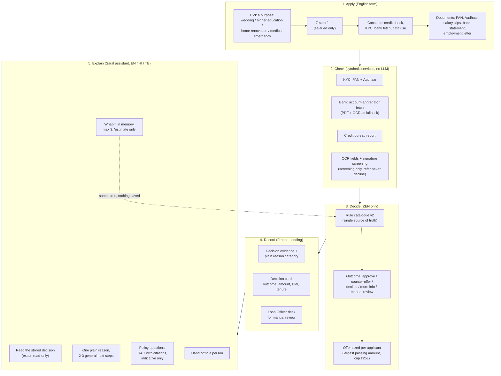
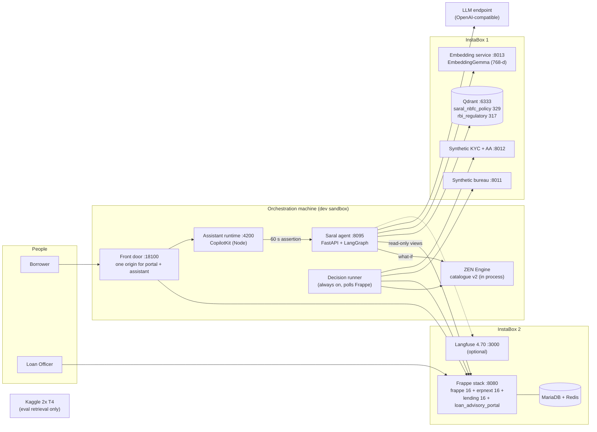
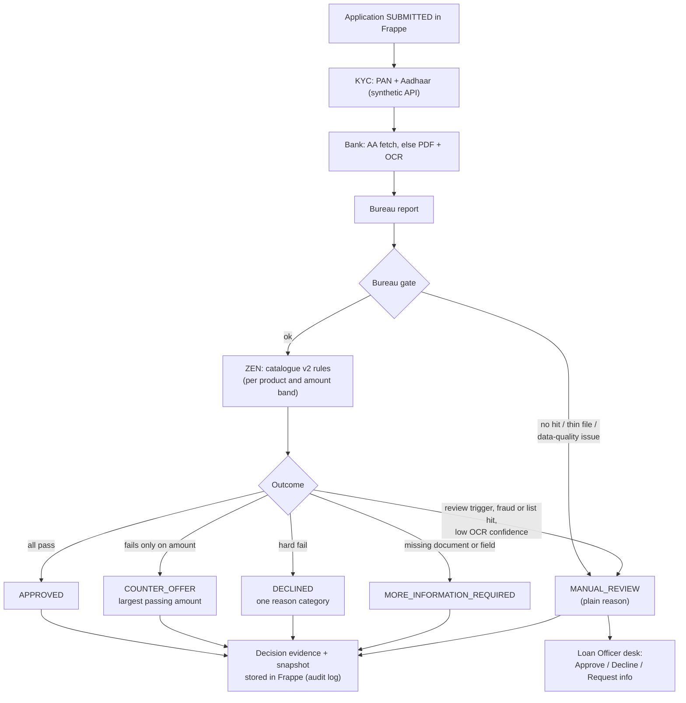
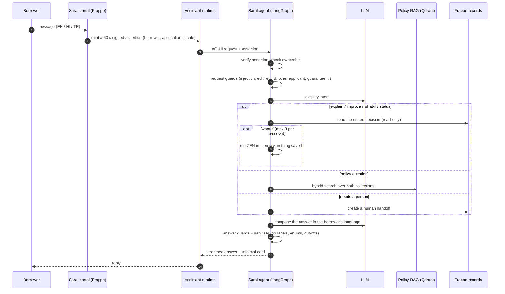
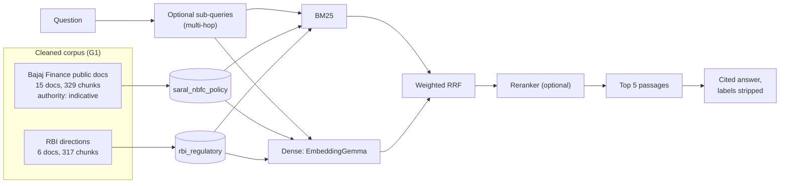

# Saral architecture and approach

State of the integration build (`saral/integration`) on 2026-11-04. All data is synthetic. Bajaj Finance Ltd is a
public reference lender, not a partner. The diagrams are Mermaid and render on GitHub. Their editable sources are also in
[`../architecture/diagrams/`](../architecture/diagrams/) as `12-saral-system.mmd`, `13-saral-approach.mmd`,
`14-saral-decision-flow.mmd`, `15-saral-agent-turn.mmd` and `16-saral-policy-rag.mmd` (SVG/PNG not rendered yet:
run `bash docs/architecture/diagrams/render.sh`). Older diagrams 01-11 in that folder
describe the pre-Saral agent and portal and are kept for history.

## 1. Approach drawing: who does what

The one idea behind Saral: **a deterministic engine decides, and the language model only explains what was decided.**

What each step never does:

| Step | Never |
|---|---|
| Check | Uses real data or real services |
| Decide | Uses an LLM or a retrieved passage |
| Record | Shows rule numbers, cut-offs or fraud words to the borrower |
| Explain | Changes the application, approves anything, names a threshold, or ties a published Bajaj number to the borrower's own case |

## 2. System and deployment (integration build)

All service ports listen on 127.0.0.1 on their own host; the orchestration machine reaches them through SSH port
forwards. Details: [INTEGRATION_DEPLOY.md](INTEGRATION_DEPLOY.md).

## 3. Decision flow (no LLM anywhere)

Design rules shown here: fraud, list and signature hits refer to a person and are never an automated decline; a
low-confidence decline is downgraded to review; missing data refers or asks for more information.

Known gaps in this flow as of 2026-11-04 03:50 IST (D-11..D-15): a bureau provider error ended as `ERROR` instead of
review; contract employment, residency and missing EMI debits did not reach the rules; a missing signature
(`INSUFFICIENT_DATA`) still approved. Status after the fixes: {{ZEN_GAP_STATUS}}.

## 4. One assistant turn

Graph nodes (`apps/api/src/loan_advisory/agent/graph.py`): `receive` → `authenticate` → `classify` →
(`boundary` | `load_evidence` | `retrieve_policy` | `simple`) → (`plan` | `what_if`) → `compose` → `validate` (one
rewrite, then a template) → `finalize`.

Agent changes queued for today (2026-11-04) and not yet reflected above: route before fetching the decision, fetch it
once and cache it; new intents for human review, distress and misrepresentation; a clarifying question for vague
messages; what-if cap enforced in the agent; an optional fast intent router (Laya, off by default). Status:
{{AGENT_FIX_STATUS}}.

## 5. Policy RAG

HDFC, ICICI and synthetic documents were removed from the corpus. ZEN rules are never indexed.
