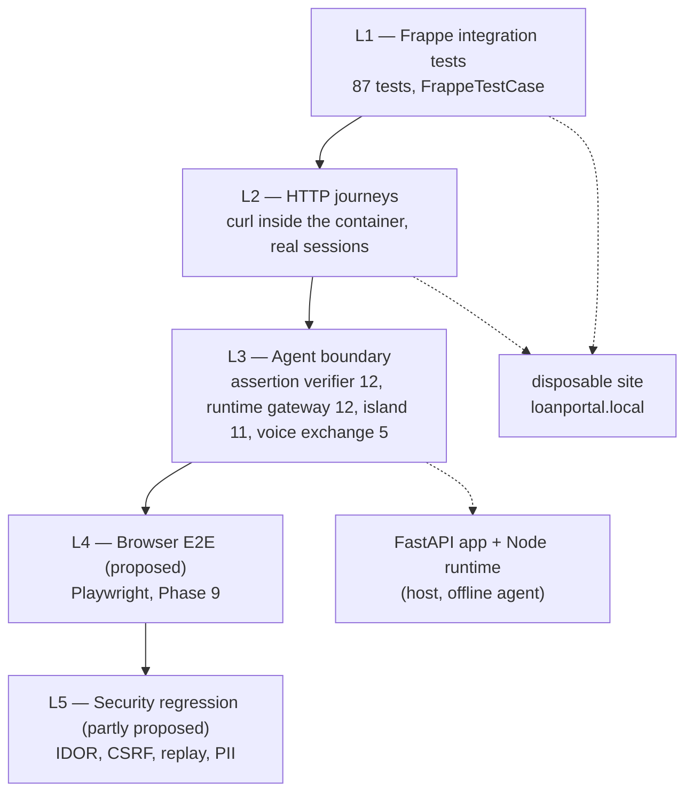

# Borrower platform test plan

What is tested today, how it is tested, and what remains before the platform can be called migrated. Everything marked **verified** was executed against `loanportal.local`: L1–L3 on 2026-10-30, L4–L5 on 2026-10-31. Nothing in this document is aspirational unless it says **proposed**.

Environment and commands: [frappe-disposable-environment.md](../development/frappe-disposable-environment.md).

> **Sections 1–9 are the Phase 9 snapshot** (87 L1 tests, 633 host tests). They are left as written because they describe what was verified at that point. Current totals, the modules added during hardening and the evidence for each hardening finding are in [Addendum B4](#addendum-b4--hardening-tests-2026-10-31), [Addendum B5](#addendum-b5--conversation-identity-and-history-2026-10-31), [Addendum C](#addendum-c--voice-consent-and-lifecycle-2026-10-31), [Addendum D](#addendum-d--remaining-screens-and-screen-matrix-2026-10-31), [Addendum E](#addendum-e--responsive-accessibility-and-lazy-load-measurements-2026-10-31), [Addendum F](#addendum-f--front-door-shared-state-and-load-2026-10-31), [Addendum G](#addendum-g--canonical-borrower-vocabulary-2026-10-31) and [Addendum H](#addendum-h--final-full-regression-2026-10-31); Phase I consolidates the final record. The per-screen record is [screen-completion-matrix.md](../migration/screen-completion-matrix.md).

## 1. Test layers

| Layer | Tool | Status | Why it exists |
| --- | --- | --- | --- |
| L1 | `bench run-tests`, `FrappeTestCase` | verified | fast regression on permissions, lifecycle, validation |
| L2 | `curl` in `loanrangers-backend-1` | verified | proves routing, redirects, CSRF and error surfaces end to end |
| L3 | L1 tests + `pytest tests/test_agent_api.py tests/test_voice_assertions.py` + `apps/runtime/test` | verified | pins the credential bridge and the agent surface end to end, offline |
| L4 | Playwright (Edge) | verified | exercises the real browser path: session cookie, island, `/api/copilotkit`, mint, FastAPI, evidence |
| L5 | Playwright + `requests` | verified | IDOR, CSRF, replay, body-override, CORS, voice bridge, logout |

## 2. L1 — integration tests (87, verified)

Command: `bench --site loanportal.local run-tests --app loan_advisory_portal` → **87 passed**.

| Module | Tests | What it pins |
| --- | ---: | --- |
| `test_borrower_access.py` | 17 | guest and non-borrower rejection, disabled user, suspended profile, unlinked customer, own vs foreign application, list scoping, selection round-trip and foreign rejection, create → **DRAFT**, submit requires a document, submit sets lifecycle and `docstatus=1`, documents frozen after submit, withdraw, amount limits, profile defaults feed a new application |
| `test_invitations.py` | 15 | issue requires System Manager, redeem binds User↔Customer↔profile, single-use token, wrong secret, expiry, revocation, duplicate email, customer with an existing portal account, password/consent rules, re-issue revokes the old link, application ownership, username derivation/override/collision/invalid |
| `test_documents.py` | 8 | attach + list, foreign application, duplicate conflict, extension allowlist, public file rejected, foreign file rejected, removal, download returns the owner's content |
| `test_agent_bridge.py` | 7 | assertion scoped to borrower + application, conversation recorded once, foreign thread rejected, foreign application 404, oversized thread rejected, `record_turn` increments and checks owner, non-borrower cannot mint |
| `test_assertion.py` | 9 | round-trip, tampered payload, wrong audience, expired, malformed, mint scoping, missing secret → 503, profile literacy/locale mapped to the agent vocabulary, unknown preferences fall back to `medium`/`en` |
| `test_feedback.py` | 5 | submit + list own, other borrowers invisible, foreign application rejected, rating/category validation, owner-scoped permission |
| `test_profile.py` | 5 | editable fields saved (with the real `cmd` kwarg), phone can be cleared, unknown field rejected, invalid values rejected, validation message reaches the browser |
| `test_livekit.py` | 3 | token signed and scoped to the room, foreign application 404, missing configuration 503 |
| `test_voice_assertion.py` | 9 | the voice worker's exchange: assertion scoped to the session's borrower + application + `voice-<session_id>` thread, a fresh one per turn, `Created → Joined`, borrower and guest refused, wrong room/identity and unknown/malformed ids 404, expired and ended sessions 409 (expiry also flips the row) |
| `test_assistant_page.py` | 7 | `?application=` scopes the island and carries the CSRF token, foreign and unknown ids are 404s, no selection renders the chooser, a cached selection mounts the island, a stale selection falls back to the chooser, a guest is redirected to sign-in |
| `test_permission_boundary.py` | 2 | no generic borrower access to Lending doctypes, borrower cannot list other Customers |

Design rules the suite enforces implicitly:

- Every test user is synthetic with a unique email, username and customer (`tests/utils.py`).
- Uploaded PDFs are content-unique per call, because Frappe de-duplicates private files by hash and a shared hash leaks across users.
- No test writes to `p1loan.local`; the fixture layer refuses to run outside a site with `allow_tests`.

## 3. L2 — HTTP journeys (verified)

Executed with `curl` inside the container against `http://127.0.0.1:8001`.

| # | Journey | Expected | Verified |
| --- | --- | --- | --- |
| 1 | Guest opens `/borrower` | `302` → `/login?redirect-to=%2Fborrower` | yes |
| 2 | Guest opens `/borrower/invite?token=…` | `200`, invite form | yes |
| 3 | Validate an invitation | `200 {invitation:{email}}`, no secret | yes |
| 4 | Redeem with password + consent | `200`, account created, session started (no second prompt) | yes |
| 5 | Sign in as borrower | `200`, `home_page=/borrower` | yes |
| 6 | Dashboard | `200`, stats + application list, CSRF token in bootstrap | yes |
| 7 | Signed-in non-borrower opens `/borrower` | `200` with blocked notice, not a login loop | yes |
| 8 | Own application page | `200`, summary, documents, timeline | yes |
| 9 | Foreign application page | `404` with “Application not found” | yes |
| 10 | Create application via `frappe.call` | `200`, `lifecycle=DRAFT`, `submitted_at=""` | yes |
| 11 | Upload private PDF, attach, download | `200` each; download returns the same bytes | yes |
| 12 | Submit without a document | `409` with a readable message | yes |
| 13 | Submit with a document | `200`, `docstatus=1`, `SUBMITTED` | yes |
| 14 | Attach after submission | `409` | yes |
| 15 | Withdraw | `200`, `WITHDRAWN`, `docstatus` kept | yes |
| 16 | Save profile | `200`, values persisted, validation error text visible | yes |
| 17 | Submit feedback | `201`-equivalent `200`, appears in own list only | yes |
| 18 | Static assets (`/assets/loan_advisory_portal/css/portal.css`, `js/portal.js`) | `200` | yes |
| 19 | Authenticated POST without CSRF | rejected (`CSRFTokenError`) | yes |
| 20 | Assertion mint (borrower session) | `200 {assertion, expires_in:60, jti, application, customer}` | yes |
| 21 | LiveKit session mint | `200 {token, url, room, identity, expires_at}`, `Voice Session` row written | yes |
| 22 | LiveKit mint as non-borrower | `403` | yes |
| 23 | Guest opens `/borrower/assistant` | `302` → `/login?redirect-to=%2Fborrower%2Fassistant` | yes |
| 24 | `?application=` on the assistant page | `200` with `#assistant-root` and `#assistant-context` (`application`, CSRF token, `literacy`, `locale`) | yes |
| 25 | Assistant page with no selection | `200` with the chooser, no island root | yes |
| 26 | Assistant page with a foreign/unknown application | `404` “Application not found” | yes |
| 27 | Island assets (`js/assistant/assistant.js`, `assistant.css`) | `200`, `text/javascript` / `text/css` | yes |

Not verified at this layer: responsive layout, keyboard-only operation and screen-reader output. L4 adds a 390 px check (no horizontal overflow, nav intact); tablet widths and assistive technology remain unmeasured. Search/filter does not exist in the portal.

## 4. L3 — agent boundary (verified)

The bridge is the security-critical seam: a browser credential must never become an agent credential directly.

Command: `PYTHONPATH=.:apps/api/src:apps/bureau/src python -m pytest tests/test_agent_api.py -q` → **12 passed** (offline agent: `ScriptedLLM` + `FakePolicy`, no network, no Frappe). Voice exchange: `python -m pytest tests/test_voice_assertions.py -q` → **5 passed** (fake HTTP session; no LiveKit). Runtime: `cd apps/runtime && npm test` → **12 passed** (real Node gateway against a Python FastAPI fixture and a stub Frappe mint endpoint). Island: `cd apps/web/assistant && npm test` → **11 passed** (jsdom, no network).

| Property | Control | Evidence |
| --- | --- | --- |
| Scope | assertion carries `sub`, `customer`, `application`, `thread`; mint resolves the application through `owned_application` | `test_agent_bridge.py::test_assertion_is_scoped_to_borrower_and_application` |
| Lifetime | 60 s TTL, 30 s skew | `test_assertion.py::test_expired_assertion_is_rejected` |
| Integrity | HMAC-SHA256 over sorted compact JSON, `compare_digest` on both sides | `test_assertion.py::test_tampered_payload_is_rejected`, `test_agent_api.py` forged-token case |
| Audience / issuer | `iss = frappe:loan_advisory_portal`, `aud = loan-advisory-agent` | `test_assertion.py::test_wrong_audience_is_rejected`, `test_agent_api.py` 401 cases |
| Single use | `jti` claimed in a process-local replay cache for 90 s | `test_agent_api.py` replayed-`jti` case |
| Body-only identity | `forwardedProps`, `x-user-id`, `x-applicant-ref` are ignored; identity and language come from claims | `test_agent_api.py` identity case, `gateway.test.ts` spoofing case |
| Credential minimisation | runtime forwards `Authorization` only — no cookie, no CSRF token, one `content-type` | `gateway.test.ts` header-minimisation case |
| Mint per run | one mint call per POST run, `thread_id` in the body | `gateway.test.ts` mint-per-run case |
| Application scoping | the run's `forwardedProps.application` is validated by shape, minted, and re-checked for ownership by Frappe; a malformed reference is dropped, a foreign one is a 404 | `gateway.test.ts` application cases, L1 `test_assistant_page` |
| Fail closed | no cookie / no CSRF / refused / empty mint → unauthenticated run → `RUN_ERROR` 401, never a fallback | `gateway.test.ts` four refusal cases |
| Cross-origin | preflight allows credentials from the configured origin only | `gateway.test.ts` CORS case |
| Conversation ownership | `Advisory Conversation.user` checked before update | `test_agent_bridge.py::test_foreign_thread_is_rejected` |
| Voice | token bound to room + metadata; `Voice Session` row precedes the token | `test_livekit.py` |
| Worker trust | worker presents only `session_id` + room + identity; Frappe checks the row, room, identity, expiry and status, then mints; no client-side credential | L1 `test_voice_assertion.py`, `tests/test_voice_assertions.py` (per-turn, status-only refusal, no credential → no request) |

## 5. L4 — browser E2E (verified 2026-10-31)

Surface: a throw-away nginx container (`tests/e2e/nginx.loanportal.conf`) publishes `127.0.0.1:8081` and pins every request to `loanportal.local` on the container-internal dev server. The shipped frontend hard-codes `p1loan.local`, so this proxy is the only way a browser can reach the disposable site without editing shared configuration. `/api/copilotkit` is proxied to the local runtime; everything else goes to Frappe.

Command: `python tests/e2e/portal_journeys.py --seed <seed.json>` → **36/36 checks**, screenshots and `journeys.json` under `tests/e2e/out/journeys`.

| Group | What the browser proves |
| --- | --- |
| Session | guest is redirected from `/login`; sign-in lands on `/borrower`; the heading, stats and application list render |
| Application detail | `NOT APPROVED` badge, two customer-visible reasons, timeline with the evaluation, one document row, private download starts with `%PDF-` |
| Assistant | island mounts against the real runtime; explain answer names `REJECTED`; intent/action/trace tags render; a what-if renders `.whatif` with the hypothetical table while the badge stays rejected; a guarantee request is refused and tagged `boundary`; "New conversation" clears the log |
| Wizard | profile prefill; empty step blocked client-side with an inline error; review summary; create → `DRAFT`; private PDF upload → one row; submit → `SUBMITTED`; "No assessment yet" before review; withdraw → `WITHDRAWN` |
| Profile | save succeeds and the value survives a reload |
| Boundaries | no request to `:8095` or `/api/agui`; no request carrying `Authorization`; no console errors; sign-out then `/borrower` redirects to login |
| Narrow viewport | six signed-in pages at 390 x 844 have no document-level horizontal overflow; the nav still exposes five links |

What is real in this run: Frappe sessions and permissions, the CopilotKit runtime, the mint, the FastAPI agent, evidence reads and the policy engine. What is local: the language model (Ollama `qwen3.5:4b` via the generic `LLM_BASE`). Swapping to the production provider changes wording, not any of the checked boundaries.

## 6. L5 — security regression harness (verified 2026-10-31)

Command: `python tests/e2e/portal_security.py --seed <seed.json>` → **39/39 checks**, written to `tests/e2e/out/security.json`. It talks HTTP directly (no browser), so it can assert status codes and bodies exactly.

| Group | Checks |
| --- | --- |
| Guests | cannot list applications (403), cannot mint (403), are redirected from the dashboard and from an application page |
| Ownership | own application and documents readable; another borrower's application, decision, documents, page and assistant page are all 404s whose bodies never contain the other borrower's purpose or customer |
| Cross-tenant payloads | the listing carries neither the other application id nor its email/customer |
| CSRF | the mint rejects a missing token and a wrong token with `CSRFTokenError` |
| Conversations | a second borrower cannot mint into or advance the first borrower's thread (403) |
| Assertion | a fresh assertion is accepted; a replay and a tampered or malformed token are refused with `sign in first` |
| Body override | a chat request naming another application/customer still answers from the asserted application (`evidence_refs` equals the victim's record) and never mentions the other file |
| Voice bridge | a borrower is refused (403); an unknown or malformed session is a 404; a service without `Agent Integration` is refused (403) |
| CORS | the runtime does not echo `https://evil.example`; it does allow the portal origin |
| Teardown | logout ends the session; the cookie can no longer list or mint |

## 7. Threat matrix

| Threat | Expected control | Current evidence | Status |
| --- | --- | --- | --- |
| IDOR on application id | `owned_application` → 404 indistinguishable from missing | L1 `test_borrower_access`, L2 #9, L5 ownership group | verified |
| IDOR on documents | file owner + application owner checks; private-only | L1 `test_documents`, L5 download checks | verified |
| IDOR on feedback / conversations | owner-scoped permissions, thread owner check | L1 `test_feedback`, `test_agent_bridge`, L5 conversation group | verified |
| Cross-customer enumeration | no list method without `ctx.customer` filter | L1 `test_permission_boundary`, L5 listing payload | verified |
| CSRF on state changes | `X-Frappe-CSRF-Token` required once the session has one | L2 #19, L5 CSRF checks | verified |
| Body-supplied identity | the request body cannot override `application`/`customer`; claims win | L3 `test_agent_api.py`, L5 override check | verified |
| Cross-origin runtime | preflight allows only the configured portal origin | `gateway.test.ts` CORS case, L5 CORS checks | verified |
| Assertion replay | `jti` claimed once inside 90 s by the verifier's replay cache | `test_agent_api.py` replayed-`jti` case | verified (single process) |
| Assertion forgery | HMAC + issuer + audience + expiry + lifetime cap | L1 `test_assertion`, `test_agent_api.py` | verified |
| PII in decision projection | only `customer_visible` failing reasons, missing fields, flags | L1 `test_borrower_access` (decision shape), L2 #8 | verified |
| PII in logs/traces | observability allowlists (agent), no message bodies in `Advisory Conversation` | `test_log_minimisation.py` (host), code review of Frappe logs | verified for traces; Frappe access logs not sampled |
| Secret leakage | site config only; invite link returns email only; no secret in responses | L1 `test_invitations`, `test_assertion` (missing secret) | verified |
| Voice token replay | 600 s TTL; the `Voice Session` row must exist and match room + identity; the worker asks for a fresh assertion per turn | L1 `test_livekit`, `test_voice_assertion`, `tests/test_voice_assertions`, L5 voice group | verified (no live room) |

## 8. Test data and isolation

- Synthetic borrowers only: `Portal Check <hex>`, `portal-check-<hex>@example.invalid`.
- Each fixture user gets a unique username; Frappe silently blanks a username derived from a taken first name, which produced a false `None` in an earlier test.
- Documents are generated in memory; the PDF producer string is unique per call.
- Tests never touch `p1loan.local`, never use production credentials and never assert on wall-clock time beyond TTL windows with skew.
- Cleanup is by test isolation (unique records), not by deleting site data. One manually uploaded file with a colliding hash was left in place rather than deleted; the fixture now prevents recurrence.

## 9. Exit criteria for this plan

The migration is test-complete when:

1. `bench run-tests` is green (87/87), host `pytest` is green (633 passed, 15 skipped), the runtime suite is green (12/12) and the island suite is green (11/11).
2. Every IDOR/CSRF/replay/override/CORS row above is **verified**, not proposed. **Met.**
3. An L4 Playwright run covers the borrower journeys on a published test surface. **Met:** 36 checks on `127.0.0.1:8081`, including a 390 px viewport pass.
4. The assertion verifier keeps its own tests: valid, expired, wrong audience, replayed `jti`, wrong issuer, body-only identity. **Met** (L3 plus the L5 replay/tamper checks over HTTP).
5. `Voice Session` transitions are exercised by the worker port. **Met** for the contract; no live LiveKit room has run.

## 10. Unresolved (Phase 9 snapshot)

> Status after hardening: the per-process replay cache was replaced by the shared Redis store in
> B1/F, and the browser suites were rerun in H. The items below are kept as the Phase 9 record;
> Addendum H and [frappe-hardening-report.md](../audit/frappe-hardening-report.md) carry the
> current status. Voice remains **unverified/BLOCKED**.

- The replay cache is per process: it holds only while the FastAPI service runs as a single uvicorn process. Multiple workers would each accept one replay.
- The runtime suite proves the gateway against a stub mint endpoint; the browser run exercises the real Frappe mint, but no *Node-level* test asserts it.
- The voice worker's exchange is tested against the `voice_assertion` contract with a fake HTTP session. No live LiveKit room has run, so the worker's room join, transcript flow and hang-up are unverified end to end.
- The L4/L5 runs used a local Ollama model (`qwen3.5:4b`). Wording-dependent checks (what-if rendering, guarantee refusal) were written as behaviour bounds, but model swaps should re-run L4.
- No load or concurrency test. The admission middleware is ported (`api/admission.py`), and one runtime test runs two applicants concurrently, but there is no throughput budget.
- Accessibility is unmeasured beyond semantic markup and the skip link; there is no automated a11y check.
- Test runtime is not tracked; five suites now run on two toolchains and should get a budget.
- The harness depends on a hand-built front door (nginx on `:8081`) and files copied into the container. A single `docker compose` profile that publishes the disposable site would make this reproducible for the owner.

## Addendum B4 — hardening tests (2026-10-31)

Phase B4 closed the audit findings **F-S05, F-S06, F-S07, F-S08, F-Z02–F-Z05, F-P03 (config only), F-P09, F-P10, F-T04**. Each finding has a test that fails without the fix, not just a code change.

| Module | Toolchain | Tests | Finding | What it pins |
| --- | --- | ---: | --- | --- |
| `tests/test_authorization_matrix.py` | L1 | 8 | IDOR / privilege escalation | Every borrower-facing whitelisted method (22 entry points) is enumerated; a completeness assertion fails if a new method is added to the API modules without appearing in the matrix. Guest → 401, non-borrower → 403, foreign application → 404 across 13 calls, client-supplied `customer`/`application`/`user` (including `frappe.form_dict` forgery) never changes the resolved owner, selection cache is scoped to the session id |
| `tests/test_response_headers.py` | L1 | 7 | F-P10 | `after_request` hook registered; CSP + baseline headers on `/borrower/*`; no CSP on static assets or `/api`; Desk untouched; HSTS only over TLS; `Retry-After` copied from a 429; an existing header is not overwritten |
| `tests/test_limits.py` | L1 | 2 | F-P09 / F-Z05 | Budget is per account, not global; `retry_after` reaches the response; guests are not counted |
| `tests/test_agent_guards.py` | host | 7 | F-S08 / F-T04 / F-Z04 | Forged identity headers (`X-Forwarded-User`, `X-Frappe-Session`, `X-Frappe-Site-Name`, `X-User`, `Remote-User`, `X-Customer`, `X-Application`, `X-App-Ref`) return 401 without a verified assertion on chat, AG-UI, bureau and stream; claims cannot be overridden; per-`sub` chat budget; bureau budget; unavailable store → 503; in-process memory store refused in production; two `RedisBudgetStore` instances share one counter |
| `tests/test_proxy_boundary.py` | host | 4 | F-S08 / F-P03 (config) | `tests/e2e/nginx.loanportal.conf` pins `Host` and `X-Frappe-Site-Name` to the disposable site, replaces `X-Forwarded-For` with `$remote_addr`, never forwards `$host`/`$http_*` to the backend, disables buffering on `/api/copilotkit`, and configures no other site |

Existing modules gained assertions rather than new files: `test_feedback.py` (borrower DocPerm removed — direct `get_list`/`insert` now raise; identity fields rejected), `test_documents.py` (`list_document_types` requires a borrower session), `test_profile.py` (identity fields are not writable through the profile API).

**Current-run totals** (executed this session, after the B4 changes):

| Suite | Command | Result |
| --- | --- | --- |
| Frappe L1 | `bench --site loanportal.local run-tests --app loan_advisory_portal` (inside `loanrangers-backend-1`) | `Ran 136 tests in 39.415s` — **OK** |
| Host | `python -m pytest` from the repo root | **662 passed, 15 skipped** |
| Lint | `ruff check apps/api/src apps/loan_advisory_portal tests` | **All checks passed!** |
| JS syntax | `node --check public/js/pages/invite.js` | clean |

Not re-run during B4 and therefore not claimed here: the L4 Playwright suite and the L5 HTTP security harness (their front door on `:8081` was not running). Browser confirmation of the header set, the invite-token URL strip and `Retry-After` is scheduled for **Phase H**; the production-shaped proxy, two-worker shared state and load budget are **Phase F** (see [rate-limits.md](../architecture/rate-limits.md)).

## Addendum B5 — conversation identity and history (2026-10-31)

Phase B5 closed **F-M02, F-S03, F-S04, F-D04, F-U01–F-U03, F-T05** (and the relinked-profile part of
F-O03). The thread is now created once, bound to one account and one application, re-checked on every
read, and restored in the island from a server-owned transcript.

| Module | Toolchain | Tests | Finding | What it pins |
| --- | --- | ---: | --- | --- |
| `tests/test_agent_bridge.py` | L1 | 16 | F-S03 / F-M02 / F-D04 / F-U01–F-U03 | Assertion scoping; selection fallback; missing selection → 409; a thread is created once and never rebound (`Conflict`); foreign thread at mint → 403; a relinked profile cannot reuse its old thread; foreign application → 404; oversized thread id refused; `record_turn` appends question + answer, titles the thread and advances `turn_count`; the transcript is capped and trimmed oldest-first; a foreign or unknown thread is 404 for both write and read; an account cannot read another's transcript; non-borrower refused |
| `tests/test_assistant_page.py` | L1 | 7 | F-T05 | The island context carries `user`, application and CSRF; a requested application scopes it; a foreign or unknown id is a 404; no selection shows the chooser; a stale selection falls back to the chooser; a guest is redirected |
| `tests/test_authorization_matrix.py` | L1 | 8 | F-T05 | `conversation_messages` joins the surface matrix: guest → 401, non-borrower → 403, foreign thread hidden as 404, and the completeness assertion still fails if a new method is unlisted |
| `tests/test_agent_api.py` | host | 14 | F-S04 / F-Z04 | AG-UI refuses a run whose `threadId` is missing from or differs from the assertion's `thread` claim (403); `/api/chat` and `/api/chat/stream` refuse a body conversation that does not match (403) and still answer when it matches |
| `tests/test_agent_guards.py` | host | 7 | identity | Unchanged claims-override proof, now minting with a bound thread so the run passes reconciliation |
| `apps/runtime/test/gateway.test.ts` | Node | 13 | refusal semantics | A Frappe 404/403/409 arrives as `RUN_ERROR` with that status (no false 401); a mint with no assertion is 503; a rebound conversation is 409; no cookie/CSRF is still a genuine 401; mint still happens exactly once per run |
| `apps/web/assistant/src/*.test.ts(x)` | Vitest | 19 | F-T05 | Context requires the account key; the thread key is `user + application` (shared-device separation); history calls use the right method/URL/CSRF; a stored turn is posted after an answer; a conflict `RUN_ERROR` resets the thread; 401 handling |

**Current-run totals** (executed this session, after the B5 changes):

| Suite | Command | Result |
| --- | --- | --- |
| Frappe L1 | `bench --site loanportal.local run-tests --app loan_advisory_portal` (inside `loanrangers-backend-1`) | `Ran 145 tests in 46.418s` — **OK** |
| Host | `python -m pytest` from the repo root | **664 passed, 15 skipped** |
| Runtime | `npm test` in `apps/runtime` | **13 passed** |
| Island | `npm test` in `apps/web/assistant` | **19 passed** |
| Typecheck | `npm run typecheck` (runtime) and `npm run typecheck` (island) | clean |
| Lint | `ruff check apps/api/src apps/loan_advisory_portal tests` | **All checks passed!** |

Not re-run during B5 and therefore not claimed here: the L4 Playwright suite and the L5 HTTP security harness. Browser confirmation that a reload restores an owned transcript, that switching application isolates history and that a conflict starts a new thread is scheduled for **Phase H**. FastAPI's LangGraph checkpointer is still per process (`MemorySaver`); a shared checkpointer is **Phase F**.

## Addendum C — voice consent and lifecycle (2026-10-31)

Phase C closed **F-M01** and the unit-testable part of **F-T06**: voice now has a consent gate, a
server-recorded notice version, an owner-scoped end, worker-side consent enforcement, and an island
panel driven by real LiveKit events. **F-Z06** (shared static worker key, no rotation) and **F-P04**
(LiveKit server/TURN/worker deployment) remain open, which is why the live test is **BLOCKED**.

| Module | Toolchain | Tests | Finding | What it pins |
| --- | --- | ---: | --- | --- |
| `tests/test_livekit.py` | L1 | 9 | F-M01 / F-T06 | Signed, room-scoped token; `session_id` returned for lifecycle; consent missing/zero → 403 and no row; consent version + timestamp stored; foreign application → 404 even without consent; missing config → 503; owner end sets `Ended` + `ended_at`; retry is idempotent; expired row reported as `Expired`; another borrower and unknown/malformed ids → 404 |
| `tests/test_voice_assertion.py` | L1 | 11 | F-T06 | The previous contract plus: a row with no consent version → 403 and status stays `Created`; a row under an older notice version → 403 |
| `tests/test_authorization_matrix.py` | L1 | 8 | F-T06 | `end_voice_session` listed in the surface matrix, POST-only, guest → 401, role-less account → 403; completeness assertion still catches unlisted methods |
| `tests/test_assistant_page.py` | L1 | 8 | F-M01 | Context carries `voice: {enabled, consent_version}`; disabled when the service is unconfigured; version always present |
| `apps/web/assistant/src/voice.test.ts` | Vitest | 5 | F-M01 | Consent `1` + application in the create body; CSRF header; keepalive on end; server refusal text and status; redirect = signed out; borrower-facing messages for 409/503/unknown |
| `apps/web/assistant/src/voice-panel.test.tsx` | Vitest | 7 | F-M01 / F-T06 | Voice-disabled state; Start disabled until consent; join uses the minted url/token and enables the mic; transcript hide/show/clear; End disconnects and posts `end_voice_session`; blocked microphone is explained and the server session is closed; reconnect is shown; 401 asks for sign-in |

**Current-run totals** (executed this session, after the C changes):

| Suite | Command | Result |
| --- | --- | --- |
| Frappe L1 | `bench --site loanportal.local run-tests --app loan_advisory_portal` (inside `loanrangers-backend-1`) | `Ran 154 tests in 46.797s` — **OK** |
| Host | `python -m pytest` from the repo root | **664 passed, 15 skipped** |
| Runtime | `npm test` in `apps/runtime` | **13 passed** |
| Island | `npm test` in `apps/web/assistant` | **33 passed** |
| Typecheck | `npm run typecheck` in `apps/web/assistant` | clean |
| Lint | `ruff check` on the app package | **All checks passed!** |
| Build | `npm run build` in `apps/web/assistant` | emitted `assistant.js` + lazy `livekit-client` chunk |

Not re-run during C and therefore not claimed here: the L4 Playwright suite and the L5 HTTP security
harness. Browser confirmation of consent, join, mute, transcript controls and hang-up is scheduled for
**Phase H**, but it cannot run until a real LiveKit URL and worker exist; the observed BLOCKED state is
recorded in [livekit-integration.md](../architecture/livekit-integration.md#live-test-blocked).

## Addendum D — remaining screens and screen matrix (2026-10-31)

Phase D added the screens that do not depend on an owner decision, wired the existing notices to the
consent checkboxes, and recorded the rest as explicit deferrals. The per-screen record is
[screen-completion-matrix.md](../migration/screen-completion-matrix.md); this addendum records the
tests and the current run.

| Module | Toolchain | Tests | Finding | What it pins |
| --- | --- | ---: | --- | --- |
| `tests/test_screens.py` | L1 | 7 | F-M04 | Help, terms and privacy render for a guest with `blocked` unset and carry their notice versions; the product page reads the enabled `Loan Product` catalogue; every canonical lifecycle state has non-empty guidance; an unknown state is described without echoing it; `get_application` carries the guidance for the application's state |
| `tests/test_profile.py` | L1 | 7 | F-M04 | Previous contract plus: accepting a notice stores `terms_version`/`privacy_version`; withdrawing privacy consent clears only its version |
| `tests/test_invitations.py` | L1 | 15 | F-M04 | Previous contract plus: redemption stores the accepted notice versions on the new profile |
| `tests/e2e` HTTP checks | L6 | — | F-M04 | Guest `GET /borrower/help`, `/borrower/products`, `/borrower/terms`, `/borrower/privacy` → 200; `/borrower` → 302 to login; products page renders the catalogue row and rate; notice pages render `portal-terms/1` / `portal-privacy/1` |

**Current-run totals** (executed this session, after the D changes):

| Suite | Command | Result |
| --- | --- | --- |
| Frappe L1 | `bench --site loanportal.local run-tests --app loan_advisory_portal` (inside `loanrangers-backend-1`) | `Ran 162 tests in 51.934s` — **OK** |
| Lint | `ruff check apps/loan_advisory_portal` | **All checks passed!** |

The host, runtime and island suites were not changed by D and were not rerun in this phase; their
Addendum C results stand as the last run for those toolchains. The Playwright journey and security
suites are still scheduled for **Phase H** (the application-page guidance rendering and the new footer
links are covered there, not here).

Deferred and not claimed: password reset / e-mail verification and invitation e-mail delivery
(F-M03/F-P11), notification centre and preferences, a public landing page, a standalone
eligibility/what-if screen, support channels and a post-registration verification state. Each needs an
owner decision recorded in the screen matrix.

## Addendum E — responsive, accessibility and lazy-load measurements (2026-10-31)

Phase E measured the ten borrower screens at 390×844, 768×1024, 1024×768, 1360×900, 1920×1080 and
320×640 (reflow), ran axe-core at mobile and laptop widths, recorded keyboard/tap-target/text-resize
checks, and counted the assistant island's initial and lazy payload. The full record, including the
request list and screenshots, is
[responsive-accessibility-performance.md](responsive-accessibility-performance.md).

| Check | Tool | Result |
| --- | --- | --- |
| Reflow, 10 screens × 6 widths | Playwright measurements | 0 px horizontal overflow everywhere |
| Automated accessibility, 10 screens × 2 widths | axe-core 4.10.2, WCAG 2.0/2.1/2.2 A+AA tags | 20 scans, **0 violations**; one incomplete check (decorative `aria-hidden` brand mark on a gradient) |
| Skip link + focus order | keyboard walk | first Tab → visible “Skip to content”; Enter → focus on `main`; 12 stops with visible outline |
| Text resize to 200% | computed overflow | 0 px on home, application, profile, feedback, help |
| Shiki / voice lazy-load | network log + local gzip | 8 eager island files (3,157,229 B raw / 778,908 B gzip); 400 chunks including Shiki grammars and `livekit-client` not requested until needed |

Defects fixed during E: the assistant chat log was a non-focusable scroll region (axe serious); the
skip link moved the URL but not focus; footer and card-head links were under the 24 px target floor.
Each change is listed in the measurement record.

**Current-run totals** (executed this session, after the E changes):

| Suite | Command | Result |
| --- | --- | --- |
| Frappe L1 | `bench --site loanportal.local run-tests --app loan_advisory_portal` (inside `loanrangers-backend-1`) | `Ran 162 tests in 44.794s` — **OK** |
| Island | `npm test` in `apps/web/assistant` | **33 passed** (6 files) |
| Island typecheck | `npm run typecheck` | clean |
| Island build | `npm run build` | rebuilt and synced the committed `public/js/assistant/` output |
| Lint | `ruff check apps/loan_advisory_portal tests/e2e/phase_e_measure.py` | **All checks passed!** |

The host (`pytest`) and runtime suites were not changed by E and were not rerun; their Addendum C
results remain the last run for those toolchains. No screen-reader or real-device session was run, and
no assistant turn was sent during the scan (the agent was not started); those remain Phase H items,
as does the browser journey/security regression.

## Addendum F — front door, shared state and load (2026-10-31)

Phase F added the production-like proxy (`infra/proxy/nginx.conf.template`), a Redis-backed
LangGraph checkpointer wired into both agents, and three live harnesses. Full record:
[production-readiness.md](production-readiness.md); JSON outputs in `tests/e2e/out/phase-f/`.

| Check | Command | Current-run result |
| --- | --- | --- |
| Proxy config invariants (text) | `pytest tests/test_production_proxy.py` | **7 passed** |
| Shared checkpointer (typed blobs, writes, listing, two graphs, fail-closed) | `pytest tests/test_shared_checkpointer.py` | **8 passed** |
| Both unit files together | `python -m pytest -q tests/test_production_proxy.py tests/test_shared_checkpointer.py` | **15 passed in 3.76s** |
| Live hostile-header proof, nginx 1.31.8 | `python tests/e2e/production_proxy_check.py` | **9/9** — literal-host 308, `/healthz` 204, foreign Host 421, pinned `Host`/`X-Frappe-Site-Name`, replaced `X-Forwarded-For`, upgrade headers forwarded, SSE gap 1.000 s, gzip 15,300 → 162 B, TLS 1.0/1.1 refused |
| Two workers, real Redis 7.4.9 | `python tests/e2e/two_worker_check.py` | **11/11** — replay refused across processes, budget 10 allowed / 11th refused (`retry_after=40`), graph `n=1→2→3` across three processes, keys under all three prefixes, memory backend refused in production |
| Modest load through the proxy | `python tests/e2e/load_check.py` | 240/240 pages 200 (p50 119.4 ms, p95 202.4 ms, p99 270.4 ms, 67.2 req/s); 400/400 `/healthz` 204 (p50 8.3 ms, p95 50.7 ms, 724.5 req/s); `portal.css` 13,502 → 4,315 B gzip. Dev server, not capacity |
| Lint | `ruff check` on the new and changed Python files | All checks passed |

The Frappe L1 suite was not rerun in F: the template, the checkpointer and the harnesses are not
imported by the portal app. The load upstream was `bench serve` (Werkzeug), so §4 of the record
explicitly does not claim production capacity. LiveKit remains **BLOCKED** and no voice call is
claimed; checkpoint retention is an owner decision (`AGENT_CHECKPOINT_TTL_S=0` keeps them).

## Addendum G — canonical borrower vocabulary (2026-10-31)

Phase G replaced the portal's ad-hoc locale/literacy lists with one contract,
`config/borrower_preferences.json` (schema `borrower-preferences/1`), vendored byte-identically
next to the app's `hooks.py` and loaded by `apps/loan_advisory_portal/loan_advisory_portal/portal/preferences.py`.
The offered values are the agent's own vocabulary — `en | hi | te` and `low | medium | high` —
and legacy stored values (`plain`, `standard`, `detailed`, `mr`) normalise on read. The
`Borrower Profile` DocType options were updated and the site migrated, so validation, page
options, and stored values agree.

| Check | Command | Current-run result |
| --- | --- | --- |
| Repo/app configs byte-identical; table, agent contract and DocType options agree | `pytest tests/test_preference_vocabulary.py` | **4 passed** |
| Page options, legacy normalisation, canonical storage, unknown rejection | `bench --site loanportal.local run-tests --app loan_advisory_portal --module loan_advisory_portal.tests.test_preferences` | **7 tests, OK** |
| Profile API unchanged behaviour | `bench ... --module loan_advisory_portal.tests.test_profile` | **7 tests, OK** |
| Assertion claims carry canonical preferences | `bench ... --module loan_advisory_portal.tests.test_assertion` | **OK** |
| Voice assertion exchange | `bench ... --module loan_advisory_portal.tests.test_voice_assertion` | **11 tests, OK** |
| Assistant page scoping | `bench ... --module loan_advisory_portal.tests.test_assistant_page` | **8 tests, OK** |
| Screens and guidance coverage | `bench ... --module loan_advisory_portal.tests.test_screens` | **OK** |
| Lint | `ruff check` on the new and changed Python files | All checks passed |

Marathi is no longer offered because the agent has no Marathi content; an old `mr` row reads as
English instead of failing. Unknown values submitted to `update_profile` are rejected with
`Forbidden`; unknown values already stored fall back to the documented defaults (`en`, `medium`)
on read. These are module runs from this branch, not the full-suite rerun — Phase H consolidates
the totals.

## Addendum H — final full regression (2026-10-31)

Run after the last code change (the island restore fix below), against the disposable site
`loanportal.local` through the test front door. Every number here is from this run.

| Surface | Command | Current-run result |
| --- | --- | --- |
| Frappe L1 | `bench --site loanportal.local run-tests --app loan_advisory_portal` | **Ran 169 tests in 52.384s — OK** |
| Host Python | `python -m pytest -q` | **683 passed, 15 skipped in 55.19s** |
| Runtime | `npm run typecheck && npm test` (apps/runtime) | typecheck clean; **13 passed, 0 failed** |
| Island | `npm run typecheck && npm test` (apps/web/assistant) | typecheck clean; **34 passed (6 files)** |
| Browser journeys | `python tests/e2e/portal_journeys.py --seed <seed>` | **36/36** — session, dashboard, decision, private download, assistant explain/what-if/refusal, history reset, wizard → upload → submit → withdraw, profile save, no direct agent calls, no Authorization header, no console errors, 390 px overflow 0 on five pages |
| HTTP security | `python tests/e2e/portal_security.py --seed <seed>` | **39/39** — guests, IDOR on every surface, CSRF, conversation ownership, replay/tamper, body override, cross-borrower answer isolation, voice refusal, CORS, logout |
| Deferred B4 browser checks | `python tests/e2e/phase_h_checks.py --seed <seed> --setup <setup>` | **17/17** — full baseline header set + CSP on public and signed-in pages, HSTS emitted only when `X-Forwarded-Proto: https`, `Retry-After: 3038` on a spent profile budget, invite token absent from the address bar and from every later request, `Referrer-Policy: no-referrer`, INFO_REQUESTED panel visible and resubmit → SUBMITTED |
| Live voice | — | **BLOCKED** — no LiveKit server, worker process or valid site credential in this environment; no call is claimed |
| Lint | `ruff check .` | All checks passed |

### Finding and fix in H

The first mount of the assistant island asked `conversation_messages` for a thread id it had
just generated, so the server correctly answered 404 and the browser logged a failed resource.
Nothing leaked and the island handled it, but the request can never have stored rows. `thread.ts`
now exposes `storedThread()` and `island.tsx` skips the restore request for threads started in
this page load (initial mount, "New conversation", conflict reset); history items still restore.
Island tests grew by one (`storedThread`). Journeys then reported **zero console errors**.

The browser run used the local Ollama model (`qwen3.5:4b`) through the generic `LLM_BASE`, so
answer wording is model-dependent; the checks are behaviour bounds, not exact strings.
